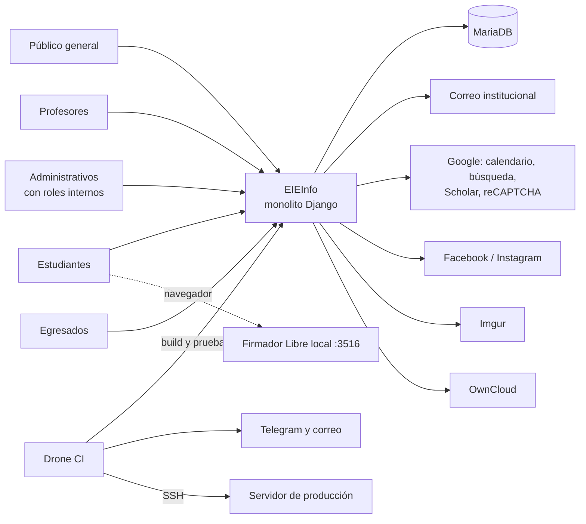
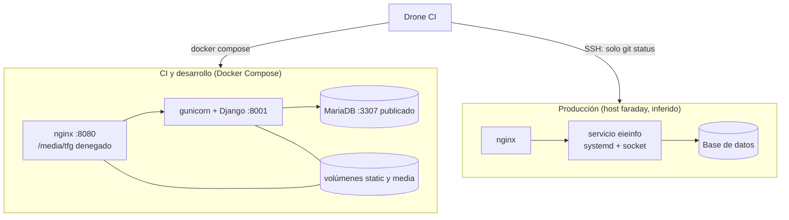
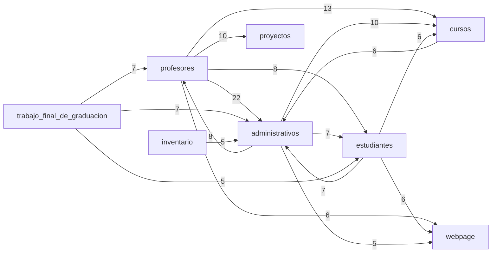

# Auditoría de diseño de software del sistema EIEInfo
## Entrega 1: Levantamiento del sistema y diagnóstico inicial

**Curso:** IE0417 – Diseño de Software para Ingeniería
**Estudiante:** _nombre, carné_
**Fecha:** _dd/mm/aaaa_
**Repositorio auditado:** _URL_ — **commit:** `d7c8c1b56b0e17a3d53af74dff1487c2f3577422` (14/10/2026)

> Convención: los IDs `E-xxx` remiten al registro de evidencia (Anexo B). Lo marcado con ⏳ es una verificación pendiente. En este informe **no se reproducen valores de credenciales**: solo archivo, línea y nombres de variables.

---

## 0. Resumen del diagnóstico

EIEInfo es un monolito Django de unas 60 000 líneas de Python, con 21 apps, diez años de historia (2016-2026) y desarrollo activo. Tiene una base funcional amplia, una cultura de pruebas real en varios módulos y un pipeline de Drone que construye contenedores, ejecuta unas 80 pruebas de humo y corre pruebas unitarias con cobertura sobre 11 apps.

Los riesgos principales se concentran en tres zonas:

1. **Secretos y configuración.** Hay credenciales y claves escritas en `settings.py`, archivos de secretos y un `.env` rastreados por Git, un token en el pipeline y un CSV con columna de contraseñas. Existen dos `settings.py` y dos `requirements.txt` que han divergido, y la configuración de producción se decide por el nombre de la máquina.
2. **Operación.** Las migraciones de Django no se versionan y se regeneran; el despliegue a producción es manual y ocurre fuera de los contenedores que prueba el CI; la plataforma (imagen base y Django 4.1) está fuera de soporte.
3. **Estructura interna.** Las apps se organizan alrededor de los portales por actor, lo que dispersa el dominio y genera acoplamiento circular: 16 de las otras 20 apps importan de `administrativos` y más de 25 pares de apps se importan mutuamente. El control de acceso se resuelve con unos 20 decoradores propios repartidos en seis apps.

## 1. Ficha técnica (§6.1)

| Aspecto | Observación | Evidencia |
|---|---|---|
| Lenguaje y versión | Python con tres referencias distintas: `.python-version` = 3.10; imagen `python:buster` con ruta fija `python3.11`; producción ⏳ | E-004, E-015 |
| Framework | Django 4.1.3, monolito | E-002 |
| Dependencias relevantes | django-polymorphic, django-ckeditor, django-select2, martor, django-wiki, sorl-thumbnail, PyPDF2, pypandoc, openpyxl/XlsxWriter, scholarly, django-crontab; `django-countries` solo en la versión Docker | E-002, E-003 |
| Base de datos | MariaDB (imagen `mariadb`, cliente `mysqlclient`) | E-014 |
| Servidor de aplicación | gunicorn (3 workers, puerto 8001) en contenedores; `eieinfo_uwsgi.ini` y, en el script de despliegue comentado, servicios `systemd` | E-014, E-009, E-018 |
| Servidor web | nginx de contenedores: `server_name localhost`, puerto 80 sin TLS, cuerpo máximo de 20 MB; `/media/tfg/` denegado y `/media/` servido directamente | E-025 |
| Despliegue observable | Dos mundos: contenedores (`docker compose`) para CI y desarrollo, y un host de producción (`faraday`) con servicios del sistema, inferido de comentarios y de `settings.py`. La configuración de producción (nginx, systemd) no está en el repositorio | E-009, E-012 |
| CI/CD | Drone: construcción, pruebas de humo, pruebas unitarias con cobertura, notificaciones por Telegram y correo, y despliegue por SSH que hoy solo ejecuta `git status` | E-009 |
| Configuración y secretos | `settings.py` + módulo `secret_credentials.py` + `.env` (variables de BD, superusuario de Django, hosts) | E-023 |
| Tareas programadas | `django-crontab`: al menos dos tareas horarias de limpieza de archivos temporales | E-021 |
| Integraciones externas visibles | Google API (calendario y búsqueda), Facebook (publicación en página), Instagram, reCAPTCHA, Let's Encrypt, Google Scholar, Imgur (editor Markdown), OwnCloud, correo SMTP, Telegram (CI) y el cliente local «Firmador Libre» (puerto 3516) para la firma digital | E-002, E-010, E-011, E-023, E-024 |
| Utilidades compartidas | `eieinfo/misc.py` (LaTeX, correo, estilos de reporte, `custom_reverse`), `eieinfo/email_service`, `eieinfo/FacebookAPI` y `webpage/misc.py` (`GetTexto`, `CrearContexto`) | E-027 |
| Control de acceso | ≈20 decoradores propios por rol, repartidos en seis `misc.py`: `administrativos` 5, `profesores` 11, `estudiantes` 1, `alumni` 1, `inventario` 1, `trabajos_finales` 1. ⏳ Confirmar si además se usan grupos o permisos de Django | E-020, E-026 |
| Generación de documentos | pandoc + TeX Live en la imagen; PyPDF2; módulo `firma_digital` | E-015 |
| Arquitectura predominante | Monolito Django organizado por apps, con portales por actor como eje principal | E-018, E-019 |

**Interpretación.** El stack es coherente para un sistema institucional que creció por incorporación de apps. La coherencia se rompe en el mantenimiento del entorno: el Dockerfile redirige `apt` a `archive.debian.org` (Debian *buster* está fuera de soporte), Django 4.1 dejó de recibir parches de seguridad en diciembre de 2023, y lo que se prueba en CI (contenedores con otra configuración) no es lo que corre en producción.

## 2. Mapa general del sistema (§6.2)

### 2.1 Diagrama de contexto

### 2.2 Diagrama de contenedores y despliegue

El flujo del pipeline (`.drone.yml`): saludo → `docker compose build` → `docker compose up` → espera fija de 200 s → pruebas de red → *setup* (sustituye `settings.py`, carga `testing.sql`, regenera migraciones, `collectstatic`) → ~80 pruebas de humo con `curl` → pruebas unitarias con `coverage` → limpieza → notificaciones → despliegue por SSH (E-009).

### 2.3 Apps, tamaño y pruebas (líneas de Python, sin migraciones)

| App | models | views | forms | tests | Observación |
|---|---:|---:|---:|---:|---|
| profesores | 293 | 5190 | 852 | 3679 | Mayor volumen de vistas; `views/consejo_asesor.py` = 2117 |
| firma_digital | 503 | 2918 | 0 | 6151 | Sin `forms.py`; pruebas = 2× las vistas |
| administrativos | 1217 | 2428 | 729 | 1853 | Modelo con más cambios del historial (166) |
| estudiantes | 1347 | 1483 | 668 | 442 | Segundo modelo más modificado (136) |
| trabajo_final_de_graduacion | 314 | 1352 | 682 | 1289 | Nombre casi homónimo de `trabajos_finales` |
| trabajos_finales | 1313 | 113 | 1056 | 66 | Mucho modelo y formulario, casi sin vistas ni pruebas; fuera del CI |
| cursos | 867 | 118 | 822 | 415 | |
| atributos | 156 | 759 | 185 | 101 | Fixtures generados en CI, pero sus pruebas no se ejecutan |
| postulaciones | 105 | 629 | 179 | 604 | |
| solicitud_documentos_externo | 182 | 511 | 150 | 1829 | |
| inventario | 537 | 448 | 547 | 34 | Casi sin pruebas; fuera del CI |
| webpage | 292 | 403 | 99 | 662 | Además aloja utilidades usadas por otras apps |
| alumni | 304 | 286 | 231 | 34 | Casi sin pruebas; fuera del CI |
| anuncios | 289 | 91 | 214 | 235 | |
| proyectos | 233 | 155 | 95 | 204 | |
| conferencias | 184 | 191 | 12 | 44 | Fuera del CI |
| laboratorios | 151 | 92 | 23 | 0 | Sin pruebas |
| eventos | 277 | 81 | 178 | 0 | Sin pruebas |
| asistencias | ⏳ | ⏳ | ⏳ | 830 | No montada en `eieinfo/urls.py`; el CI la marca «App no habilitada» |
| practica_profesional, proyecto_electrico | ⏳ | ⏳ | ⏳ | ⏳ | No montadas en `eieinfo/urls.py`; su funcionalidad vive en `urlpatterns` de las apps de actor |

### 2.4 Dependencias entre apps (matriz de imports)

Se contaron las sentencias `from x import` e `import x` de nivel de módulo entre apps (incluye pruebas; no detecta imports dentro de funciones ni relativos). Fuente: E-019.

_Solo se dibujan dependencias con 5 o más imports._

| App | Apps distintas que la importan (fan-in) | Apps distintas que importa (fan-out, sin `eieinfo`) |
|---|---:|---:|
| administrativos | **16** | 9 |
| webpage | 12 | 10 |
| estudiantes | 10 | 10 |
| profesores | 10 | **12** |
| cursos | 8 | 1 |

**Lectura.** `administrativos` funciona como núcleo del que casi todo depende (79 sentencias desde 16 apps) y a la vez importa de `profesores`, `estudiantes`, `cursos` y `webpage`. Hay más de 25 pares de apps con dependencia en ambos sentidos (por ejemplo `administrativos`–`profesores`: 22 y 8; `administrativos`–`estudiantes`: 7 y 7; `profesores`–`cursos`: 13 y 2).

En cambio, las dependencias hacia `webpage` y `eieinfo` son sobre todo de **utilidades compartidas**: `webpage.misc` (`GetTexto`, `CrearContexto`, `GetDocumento`) y `eieinfo.misc` (`GenerarLaTeX`, `EnviarEmailTemplate`, `RecibirEmailSimple`, `CrearEstilosReporte`, `custom_reverse`), además de `eieinfo.email_service` y `eieinfo.FacebookAPI`. No existe un módulo común independiente: el sitio público y el paquete del proyecto hacen de biblioteca. Varios módulos importan `eieinfo.settings` directamente en lugar de `django.conf.settings` (E-027). ⏳ Falta determinar qué se importa concretamente de `administrativos`.

### 2.5 Puntos de entrada (`eieinfo/urls.py`)

| Prefijo | App | Observación |
|---|---|---|
| `/estudiantes/`, `/profesores/`, `/administrativos/` | portales por actor | Cada uno incluye entre 8 y 11 sub-`urlpatterns` por funcionalidad |
| `/alumni/` | alumni | Bolsa de empleo y zona pública |
| `/cursos/`, `/proyectos/`, `/laboratorios/`, `/inventario/`, `/postulaciones/`, `/atributos/` | apps de dominio | |
| `/anuncios/`, `/eventos/`, `/conferencias/` | difusión | |
| `/trabajos_finales/`, `/trabajo_final_de_graduacion/` | trabajos finales | Dos apps con dominio solapado |
| `/firma_digital/`, `/solicitud_documentos_externo/` | documentos | |
| `/martor/`, `/.well-known/` | editor Markdown, Let's Encrypt | |
| `/` | webpage | Sitio público; su `include` queda antes de cuatro apps (`atributos`, `firma_digital`, `trabajo_final_de_graduacion`, `solicitud_documentos_externo`) |
| `/admin/` | Django admin | |

`asistencias`, `practica_profesional` y `proyecto_electrico` no tienen prefijo propio: sus rutas se montan dentro de `profesores`, `estudiantes` y `administrativos` (E-018).

## 3. Inventario funcional (§6.3)

### 3.1 Actores y roles

| Actor | Portal | Roles detectados (decoradores) | Evidencia |
|---|---|---|---|
| Público general | `/` | — | `.drone.yml`, `webpage` |
| Estudiantes | `/estudiantes/home/…` | estudiante; bodega (`inventario`); proyecto eléctrico (`trabajos_finales`) | E-020, E-026 |
| Profesores | `/profesores/home/…` | profesor, director, director real, comisión de docencia, consejo asesor, comisión TFG, revisor TFG, comisión de práctica profesional, comisiones | E-026 |
| Administrativos | `/administrativos/home/…` | administrador, gestión de inventario, jefatura administrativa, recepción, asuntos estudiantiles | E-020 |
| Egresados | `/alumni/home/…` | alumni | E-026 |
| Administración técnica | `/admin/` | superusuario de Django | `.drone.yml` |

### 3.2 Áreas funcionales × actores

| Área funcional | Estudiantes | Profesores | Administrativos | Egresados |
|---|:-:|:-:|:-:|:-:|
| Cursos y asistencias | ✔ | ✔ | ✔ | |
| Proyecto eléctrico | ✔ | ✔ | | |
| Práctica profesional | ✔ | ✔ | ✔ | |
| Consejo asesor y nombramientos | | ✔ | ✔ | |
| Noticias (anuncios y eventos) | | ✔ | ✔ | |
| Inventario, bodega y reservaciones | ✔ (bodega) | | ✔ | |
| Proyectos y laboratorios | | ✔ | | |
| Bolsa de empleo | ✔ | | | ✔ |
| Firma digital y solicitud de documentos | ⏳ | ⏳ | ⏳ | |

La misma funcionalidad aparece en dos o tres apps de actor (por ejemplo `consejo_asesor` en `profesores` y `administrativos`; `practica_profesional` en las tres), lo que explica el tamaño de esas apps y su acoplamiento.

### 3.3 Flujos visibles (reconstruidos del smoke test del CI)
- **Estudiante:** login → cursos → asistencias en concurso y propias → proyecto eléctrico en concurso → ofertas de práctica y empleo.
- **Administrativo:** login → consejo asesor (nombramientos interinos y de continuidad, comisiones, proyectos, ciclo) → noticias → lugares → recursos.
- **Profesor:** login → mis nombramientos → publicaciones → proyecto eléctrico (listar, crear) → cursos.
- **Firma digital:** el navegador se comunica con un firmador local en el puerto 3516 (configuración de `firma_digital`). ⏳ Rastrear el flujo completo en la Entrega 2.

### 3.4 Módulos críticos
Criterio: fan-in, volumen de código, frecuencia de cambio y control de acceso. `administrativos` (fan-in 16, decoradores de rol, modelo más modificado), `profesores` (más vistas, mayor fan-out, 11 roles), `estudiantes`, `cursos`, `webpage` (entrada pública y utilidades compartidas) y `firma_digital` (desarrollo más reciente).

## 4. Hallazgos iniciales (§6.4)

### H-01 · Secretos versionados en varias ubicaciones
- **Criticidad:** Crítica
- **Descripción:**
  (a) `src/server/eieinfo/settings.py` tiene escritos en el código la contraseña del servidor de correo (línea 345) y el identificador y la clave de la API de Imgur (líneas 428-429). La versión `docker/django/settings.py` usa marcadores de posición en esas mismas líneas, por lo que los valores del repositorio parecen reales (no se validaron).
  (b) `docker/django/.env` y `docker/django/secret_credentials.py` están rastreados. Por sus nombres de variables, el primero contiene credenciales de BD y de superusuario de Django, y el segundo `SECRET_KEY`, `DATABASES`, credenciales de correo, claves de Google (búsqueda y calendario), token de página de Facebook y claves de reCAPTCHA. ⏳ Se desconoce si son valores reales o de desarrollo.
  (c) El paso `notify` de `.drone.yml` contiene el token de un bot de Telegram en texto plano, mientras otros secretos del mismo archivo usan `from_secret`.
  (d) El `.gitignore` excluye `src/server/eieinfo/secret` (el destino de la copia en la imagen), no el origen versionado.
- **Evidencia:** `settings.py:345, 428-429` (E-011); `git ls-files` y nombres de variables (E-013, E-023); `.drone.yml`, paso `notify` (E-010).
- **Impacto:** Cualquier persona con acceso de lectura al repositorio o a su historial obtiene credenciales y claves; rotarlas no basta si siguen en el historial. Una `SECRET_KEY` expuesta compromete tokens firmados y sesiones; el token de Facebook permitiría publicar en la página.

### H-02 · Migraciones ignoradas por diseño y regeneradas en cada arranque
- **Criticidad:** Crítica
- **Descripción:** `.gitignore` excluye `src/server/*/migrations/*` salvo `__init__.py`, y Git solo rastrea 18 archivos `__init__.py`. `migraciones.sh` elimina todas las migraciones y ejecuta `makemigrations` y `migrate` en cada arranque del contenedor; el CI hace lo mismo (con `migrate` comentado y carga de `testing.sql`). En el script de despliegue comentado, `makemigrations` y `migrate` se ejecutarían en el servidor, lo que sugiere que el historial real de migraciones de producción solo existe allí (⏳ confirmar).
- **Evidencia:** `.gitignore` y `git ls-files | grep migrations` (E-008); `docker/django/migraciones.sh` (E-007); `.drone.yml`, pasos `setup-eieinfo` y `deployment` (E-009).
- **Impacto:** No hay historial versionado del esquema; los cambios de modelo sobre una BD existente no se aplican de forma controlada, no se pueden revertir ni reproducir en otro entorno.

### H-03 · Seguridad dependiente del entorno, con valores por defecto inseguros
- **Criticidad:** Alta
- **Descripción:** (a) `settings.py` activa las opciones de producción solo si `socket.gethostname()` es `faraday`; en cualquier otro caso arranca con `DEBUG = True` y `ALLOWED_HOSTS = ['*']`. (b) `docker/django/settings.py` fija `DEBUG = True`, deja `SESSION_COOKIE_SECURE = False` y confía en el encabezado `X-Forwarded-Proto` (`SECURE_PROXY_SSL_HEADER`), pero el nginx de contenedores no lo establece, de modo que un cliente podría falsificarlo.
- **Evidencia:** `src/server/eieinfo/settings.py:478-493` (E-012); `diff` de ambos `settings.py` (E-024); `docker/nginx/default.conf` (E-025).
- **Impacto:** Un servidor migrado, renombrado o ejecutado en contenedor funcionaría en modo depuración, exponiendo trazas y configuración. La seguridad depende de un nombre de host.

### H-04 · Despliegue a producción manual, fuera de contenedores y sin configuración versionada
- **Criticidad:** Alta
- **Descripción:** El paso `deployment` de Drone solo ejecuta `cd info` y `git status`; el respaldo de BD, `git pull`, migraciones y reinicio de servicios están comentados. Se marca `failure: ignore` y se autentica por SSH con contraseña (guardada como secreto). Producción corre con servicios del sistema, y su configuración de nginx y `systemd` no está en el repositorio: solo existe la de contenedores y `eieinfo_uwsgi.ini`.
- **Evidencia:** `.drone.yml`, paso `deployment` (E-009); `settings.py:478-493` (E-012); `docker-compose.yml` (E-014); `docker/nginx/` (E-025).
- **Impacto:** Las pruebas del CI no representan el entorno real; el despliegue depende de pasos manuales sin respaldo automatizado ni verificación posterior; el entorno de producción no es reconstruible desde el repositorio.

### H-05 · Configuración y dependencias divergentes entre entornos
- **Criticidad:** Alta
- **Descripción:** El `diff` entre `src/server/eieinfo/settings.py` y `docker/django/settings.py` produce 16 bloques de diferencias. La configuración que usa el CI (copiada sobre la del repositorio antes de las pruebas) **no define ajustes de `firma_digital`** presentes en la del repositorio (`MAX_PDF_SIZE`, `FIRMA_DIGITAL_UPLOAD_PATH`, `FIRMADOR_LIBRE_PORT`, `DEFAULT_FIRMA_DEADLINE_DAYS`), pero sí añade `django_countries`, que el `settings.py` del repositorio no registra. Los dos `requirements.txt` también difieren: el de la raíz instala forks desde la rama `main` y `django-tagging` duplicado; el de Docker usa `django-wiki` 0.10.1 oficial y `django-countries>=7.0` sin fijar, y por eso el Dockerfile parchea `django-tagging` con `sed` en `site-packages`. Python se declara en 3.10 y la imagen usa 3.11. ⏳ Verificar si el código de `firma_digital` lee esos ajustes con valores por defecto.
- **Evidencia:** `diff` de `settings.py` (E-024); `diff` de `requirements.txt` (E-003); `.python-version` (E-004); `docker/django/Dockerfile` (E-015); `.drone.yml`, pasos `setup-eieinfo` y `unit-testing-eieinfo` (E-009).
- **Impacto:** Lo que se prueba, lo que se construye y lo que se ejecuta pueden diferir; las pruebas del módulo más activo corren con una configuración incompleta; construcciones no reproducibles y dependientes de ramas mutables de terceros.

### H-06 · Plataforma y dependencias fuera de soporte
- **Criticidad:** Alta
- **Descripción:** Imagen `python:buster` sin versión fija (Debian *buster*, con `apt` redirigido a `archive.debian.org`); Django 4.1.3; `google-api-python-client` 1.5.3, `oauth2client` 3.0.0, `facebook-sdk` 2.0.0, `docutils` 0.12 y `PyPDF2` 1.26.0, presentes en ambos `requirements`. La imagen corre como root e incluye TeX Live y `nano`.
- **Evidencia:** `docker/django/Dockerfile` (E-015); `requirements.txt` y `docker/django/requirements.txt` (E-002, E-003). ⏳ Falta `pip-audit` para citar CVE concretos.
- **Impacto:** Vulnerabilidades conocidas sin parche y bloqueo de futuras actualizaciones.

### H-07 · Acoplamiento circular con `administrativos` como núcleo y sin capa común
- **Criticidad:** Alta
- **Descripción:** 16 de las otras 20 apps importan de `administrativos` (79 sentencias), que a su vez importa de `profesores`, `estudiantes`, `cursos` y `webpage`; más de 25 pares de apps se importan mutuamente. Además, las utilidades compartidas viven en `webpage.misc` y `eieinfo.misc`, y varios módulos importan `eieinfo.settings` directamente.
- **Evidencia:** Matriz de imports (E-019); imports de `eieinfo` y `webpage` (E-027).
- **Impacto:** Los módulos no se pueden entender, probar ni cambiar de forma aislada; un cambio en `administrativos` o en `webpage.misc` tiene un radio de impacto amplio. ⏳ Verificar qué se importa de `administrativos` (modelos, decoradores o utilidades).

### H-08 · Cobertura de pruebas parcial y tolerancia a fallos conocidos
- **Criticidad:** Media
- **Descripción:** El CI ejecuta pruebas unitarias con cobertura sobre 11 de las 21 apps, sin umbral mínimo (`coverage report` solo imprime). No se ejecutan `alumni`, `atributos`, `conferencias`, `eventos`, `inventario`, `laboratorios` ni `trabajos_finales`. Seis URL del smoke test están desactivadas (cinco con nota de falla conocida). El script local `run-ut.sh` quedó desactualizado: solo corre 2 apps y marca `profesores` como «Fallan». Los fixtures se generan con `dumpdata` sobre la BD de prueba.
- **Evidencia:** `.drone.yml`, pasos `test-eieinfo-urls` y `unit-testing-eieinfo` (E-009, E-022); `docker/django/run-ut.sh` (E-016); `recon/03-apps.txt` (E-006).
- **Impacto:** Inventario y trabajos finales (más de 3000 líneas de modelos y formularios) evolucionan sin red de seguridad, y los defectos conocidos se esconden en lugar de corregirse. Fortaleza relacionada: el CI existe y cubre los módulos centrales.

### H-09 · Pipeline de CI frágil y con privilegios amplios
- **Criticidad:** Media
- **Descripción:** Monta el socket de Docker del anfitrión; usa una espera fija de 200 s en lugar de comprobar el estado; la carga de `testing.sql` fuerza errores y los oculta (`-f`, `2> /dev/null`); la limpieza elimina imágenes llamadas `nginx` y `mariadb` y volúmenes del daemon compartido; usa cuentas de prueba con contraseñas triviales (⏳ confirmar que no existen en producción).
- **Evidencia:** `.drone.yml` (E-009, E-022).
- **Impacto:** Pruebas intermitentes y errores silenciados; un paso comprometido tendría control sobre el daemon de Docker del servidor de CI.

### H-10 · Módulos de vistas sobredimensionados
- **Criticidad:** Media
- **Descripción:** `profesores` acumula 5190 líneas de vistas (una sola, `consejo_asesor.py`, tiene 2117) y `firma_digital/views.py` tiene 2918 con una app sin `forms.py`.
- **Evidencia:** `recon/03-apps.txt`, `recon/04-py-grandes.txt` (E-005).
- **Impacto:** Alta carga cognitiva y probable mezcla de validación, reglas de negocio y presentación. ⏳ Confirmar leyendo los archivos.

### H-11 · Dominio disperso por la organización en portales de actor
- **Criticidad:** Media
- **Descripción:** Funcionalidades como consejo asesor, práctica profesional, proyecto eléctrico y asistencias se implementan como `urlpatterns` y vistas dentro de `profesores`, `estudiantes` y `administrativos`, mientras `asistencias`, `practica_profesional` y `proyecto_electrico` existen como apps sin montar. Además, `trabajos_finales` y `trabajo_final_de_graduacion` tienen nombres y dominio solapados, y `trabajos_finales` tiene 1313 líneas de modelos con 113 de vistas.
- **Evidencia:** `eieinfo/urls.py` y `urlpatterns` de los portales (E-018); `recon/03-apps.txt` (E-005).
- **Impacto:** Conceptos duplicados o ambiguos y límites difusos, lo que encarece cualquier cambio en estos flujos.

### H-12 · Los modelos centrales son los archivos con mayor rotación
- **Criticidad:** Media
- **Descripción:** `administrativos/models.py` (166 cambios, 1217 líneas), `estudiantes/models.py` (136, 1347) y `cursos/models.py` (128, 867) encabezan el historial, junto con `settings.py` (122) y `.drone.yml` (74).
- **Evidencia:** `recon/10-git.txt` (E-017).
- **Impacto:** Núcleos del dominio inestables y grandes; combinados con H-02, cada cambio de modelo es riesgoso.

### H-13 · Conocimiento concentrado en una persona
- **Criticidad:** Media
- **Descripción:** Un autor acumula 1160 de 2567 commits (≈45 %), y hay identidades duplicadas del mismo autor (sin `.mailmap`).
- **Evidencia:** `recon/10-git.txt` (E-017).
- **Impacto:** Riesgo de dependencia de conocimiento y de trazabilidad deficiente. En el informe se refiere como «autor principal».

### H-14 · Archivo CSV con columna de contraseñas y datos de personas, rastreado en el repositorio
- **Criticidad:** Alta (⏳ por confirmar el contenido)
- **Descripción:** `src/server/OwncloudProfesores.csv` está versionado y su cabecera incluye nombre, apellidos, usuario y contraseña; se relaciona con `owncloud_config.sh`. También se rastrea `scripts/TODO_ACTUALIZADO.csv`, en una carpeta que el `.gitignore` excluye. ⏳ Contar cuántas filas tienen la columna de contraseña llena, sin imprimir su contenido.
- **Evidencia:** `git ls-files` (E-013); cabecera del CSV (E-028).
- **Impacto:** Datos personales de profesores y una posible lista de credenciales en el historial del repositorio.

### H-15 · Control de acceso fragmentado entre capas y apps
- **Criticidad:** Media
- **Descripción:** La autorización se resuelve con unos 20 decoradores propios distribuidos en seis `misc.py` (`profesores` define 11, varios compuestos por nombre, como `profesor_or_comision_docencia_or_consejo_asesor_login_required`). Además, la protección de los archivos de TFG se hace en nginx con una regla específica (`/media/tfg/` denegado), mientras el resto de `/media/` se sirve directamente. ⏳ Verificar si existen vistas sin decorador y qué archivos sensibles se guardan fuera de `/media/tfg/`.
- **Evidencia:** `administrativos/misc.py` (E-020); decoradores de las demás apps (E-026); `docker/nginx/default.conf` (E-025).
- **Impacto:** Es difícil auditar la matriz de roles y permisos; una vista sin el decorador adecuado, o un archivo sensible fuera de la ruta protegida, queda expuesto sin que ninguna capa lo detecte.

### Resumen

| ID | Título | Criticidad | Área |
|---|---|---|---|
| H-01 | Secretos versionados | Crítica | Seguridad |
| H-02 | Migraciones ignoradas y regeneradas | Crítica | Operación / datos |
| H-03 | Seguridad dependiente del entorno | Alta | Seguridad / configuración |
| H-04 | Despliegue manual, fuera de contenedores | Alta | Operación |
| H-05 | Configuración y dependencias divergentes | Alta | Operación |
| H-06 | Plataforma fuera de soporte | Alta | Dependencias |
| H-07 | Acoplamiento circular sin capa común | Alta | Arquitectura |
| H-14 | CSV con contraseñas y datos de personas | Alta (⏳) | Seguridad |
| H-08 | Cobertura de pruebas parcial | Media | Pruebas |
| H-09 | CI frágil y privilegiado | Media | Operación |
| H-10 | Vistas sobredimensionadas | Media | Diseño |
| H-11 | Dominio disperso por actor | Media | Dominio |
| H-12 | Modelos centrales con alta rotación | Media | Mantenibilidad |
| H-13 | Conocimiento concentrado | Media | Proceso |
| H-15 | Control de acceso fragmentado | Media | Seguridad / diseño |

## 5. Matriz preliminar de riesgos (§6.5)

Escala: Impacto y Probabilidad de 1 a 3. Prioridad = I × P (1-2 baja, 3-4 media, 6-9 alta).

| ID | Riesgo | Posible causa | Impacto | Prob. | Prioridad | Hallazgos |
|---|---|---|---|---|---|---|
| R-01 | Esquema de BD inconsistente o irrecuperable tras un cambio de modelo | Migraciones no versionadas y regeneradas | 3 | 3 | 9 (alta) | H-02, H-12 |
| R-02 | Uso indebido de cuentas, claves o datos de personas | Secretos y un CSV con contraseñas en el repositorio y su historial | 3 | 2 | 6 (alta) | H-01, H-14 |
| R-03 | Exposición de datos y trazas en un servidor | Modo depuración por defecto; cabeceras de proxy no controladas | 3 | 2 | 6 (alta) | H-03 |
| R-04 | Despliegue erróneo o irrecuperable | Proceso manual, sin respaldo automático; entornos divergentes | 2 | 3 | 6 (alta) | H-04, H-05 |
| R-05 | Explotación de vulnerabilidades conocidas | Django, SO base y librerías sin soporte | 3 | 2 | 6 (alta) | H-06 |
| R-06 | Cambios lentos y con efectos colaterales | Acoplamiento circular, vistas gigantes, dominio disperso | 2 | 3 | 6 (alta) | H-07, H-10, H-11 |
| R-07 | Regresiones en módulos sin pruebas o probadas con configuración incompleta | Apps fuera del CI; configuración de CI distinta de la real | 2 | 2 | 4 (media) | H-05, H-08 |
| R-08 | Pérdida de conocimiento operativo | Autor principal con ≈45 % de los commits | 2 | 2 | 4 (media) | H-13 |
| R-09 | Acceso indebido por autorización ausente o incorrecta en alguna vista | Control de acceso repartido en ~20 decoradores y reglas de nginx | 3 | 1 | 3 (media) | H-15 |
| R-10 | Compromiso del servidor de CI | Socket de Docker montado, limpieza global, cuentas triviales | 3 | 1 | 3 (media) | H-09 |

## 6. Respuesta a las preguntas orientadoras

1. **¿Qué tan centralizado o fragmentado está el sistema?** Es un solo despliegue, pero con una centralización de hecho en `administrativos` (fan-in 16) y en utilidades alojadas en `webpage` y `eieinfo`, y una fragmentación conceptual del dominio entre portales de actor y apps casi homónimas (H-07, H-11).
2. **¿Qué módulos concentran más responsabilidad?** `administrativos` como dependencia común, `profesores` por volumen de vistas, mayor fan-out y 11 roles, y `firma_digital` por el tamaño de sus vistas (H-07, H-10, H-15).
3. **¿Qué partes parecen más activas y cuáles más legadas?** Activas: `firma_digital` (último merge), los modelos centrales y `.drone.yml`. Legado: `resources/` (sin cambios desde 2019), `eieinfo_uwsgi.ini`, `start.sh` con `runserver`, `profesores/my_views/` junto a `views/`, las apps sin montar y las apps sin pruebas ni cambios recientes.
4. **¿Qué señales hay de crecimiento orgánico y deuda técnica?** Diez años de historia, un autor dominante, dos configuraciones y dos listas de dependencias que divergieron, parches sobre librerías de terceros, scripts con líneas comentadas, fallos conocidos desactivados en las pruebas y decoradores de autorización compuestos por nombre.
5. **¿Dónde están los primeros riesgos de mantenimiento o evolución?** En los secretos y la configuración (H-01, H-03, H-05), en la operación (migraciones, despliegue manual, plataforma obsoleta: H-02, H-04, H-06) y en el acoplamiento circular entre apps (H-07).

## 7. Conclusiones

**Fortalezas rescatables:**
- Un pipeline de CI real que construye, prueba y notifica, con unas 80 pruebas de humo y cobertura sobre 11 apps.
- Cultura de pruebas amplia en `firma_digital`, `profesores`, `administrativos` y `solicitud_documentos_externo`.
- Uso de secretos de Drone para el correo y el SSH, y `healthcheck` en el servicio de base de datos.
- Roles explícitos y nombrados en los decoradores, y protección específica de los archivos de TFG en nginx (`/media/tfg/` denegado; acceso solo por vistas de Django).
- Desarrollo activo hasta octubre de 2026 y una división por apps de dominio que puede servir de base a un monolito modular.

**Pendiente para la Entrega 2:** auditoría profunda de `administrativos`, `profesores`, `firma_digital`, `estudiantes` y del conjunto `trabajos_finales` / `trabajo_final_de_graduacion`; qué se importa de `administrativos`; verificación de vistas sin decorador; `pip-audit`; recuento (sin imprimir) de filas con contraseña en el CSV; y comprobación de si los secretos rastreados son reales o de desarrollo.

## Anexos
- A. Salidas crudas: `docs/anexos/recon/`
- B. Registro de evidencia (abajo), para copiar a `docs/anexos/evidencia.md`
- C. Diagramas: `docs/diagramas/`

### Anexo B · Registro de evidencia

| ID | Ubicación | Observación |
|---|---|---|
| E-001 | git HEAD | Commit base `d7c8c1b…` |
| E-002 | `requirements.txt` | Django 4.1.3; dependencias de 2016-2017; forks desde rama; `django-tagging` duplicado |
| E-003 | `docker/django/requirements.txt` | Difiere del de la raíz: `django-wiki` 0.10.1, sin fork de tagging, `pytest` fijado, `django-countries>=7.0` |
| E-004 | `.python-version` | 3.10 (la imagen usa 3.11) |
| E-005 | `recon/03-apps.txt`, `recon/04-py-grandes.txt` | Tamaños por app y archivos grandes |
| E-006 | `recon/03-apps.txt` | Apps sin pruebas o con 34 líneas |
| E-007 | `docker/django/migraciones.sh` | `find … -delete` de migraciones + `makemigrations` + `migrate` |
| E-008 | `.gitignore`; `git ls-files \| grep migrations` | Migraciones ignoradas; 18 archivos `__init__.py` rastreados |
| E-009 | `.drone.yml` | Etapas del pipeline; `deployment` solo ejecuta `git status`; cobertura sobre 11 apps |
| E-010 | `.drone.yml`, paso `notify` | Token de Telegram en texto plano (valor no reproducido) |
| E-011 | `src/server/eieinfo/settings.py:345, 428-429` | Contraseña SMTP y claves de Imgur en texto plano (valores no reproducidos); marcadores de posición en la versión Docker |
| E-012 | `src/server/eieinfo/settings.py:478-493` | Producción solo si `hostname == 'faraday'`; si no, `DEBUG = True` y `ALLOWED_HOSTS = ['*']` |
| E-013 | `git ls-files` | Rastreados: `docker/django/.env`, `docker/django/secret_credentials.py`, dos CSV |
| E-014 | `docker-compose.yml` | Credenciales triviales de BD, puerto 3307, puertos 8000/8001 publicados |
| E-015 | `docker/django/Dockerfile` | `python:buster`, `apt` hacia `archive.debian.org`, reemplazo de `settings.py`, copia de `secret_credentials.py`, `sed` sobre `site-packages` |
| E-016 | `docker/django/run-ut.sh`, `start.sh` | Script local desactualizado (2 apps, `profesores` «Fallan»); `runserver` |
| E-017 | `recon/10-git.txt` | 2567 commits; autor con 1160; archivos con más cambios; último commit por carpeta |
| E-018 | `ls src/server`; `eieinfo/urls.py` | 21 apps; 3 sin montar; `eieinfo_uwsgi.ini`; prefijos de URL |
| E-019 | Matriz de imports entre apps | Fan-in/fan-out; más de 25 pares con dependencia mutua |
| E-020 | `recon/08-auth.txt` | 5 decoradores de rol en `administrativos/misc.py` |
| E-021 | `src/server/eieinfo/settings.py` (CRONJOBS) | Dos tareas horarias de limpieza |
| E-022 | `.drone.yml` | Socket de Docker montado, `sleep 200`, seis URL desactivadas |
| E-023 | `docker/django/.env`, `secret_credentials.py` (nombres de variables, valores redactados) | BD, superusuario, `SECRET_KEY`, correo, claves de Google, token de Facebook, reCAPTCHA |
| E-024 | `diff src/server/eieinfo/settings.py docker/django/settings.py` | 16 bloques de diferencias; faltan ajustes de `firma_digital`; `DEBUG = True` y cookies no seguras en la versión Docker |
| E-025 | `docker/nginx/default.conf` | Sin TLS, 20 MB, no fija `X-Forwarded-Proto`; `/media/tfg/` denegado, `/media/` público |
| E-026 | `grep "def .*login_required"` | `profesores` 11, `estudiantes` 1, `alumni` 1, `inventario` 1, `trabajos_finales` 1 decoradores propios |
| E-027 | `grep` de imports de `eieinfo` y `webpage` | Utilidades compartidas en `webpage.misc` y `eieinfo.misc`; import directo de `eieinfo.settings` |
| E-028 | `head -1 src/server/OwncloudProfesores.csv` | Cabecera con columnas Nombre, Apellidos, Usuario, Contraseña |