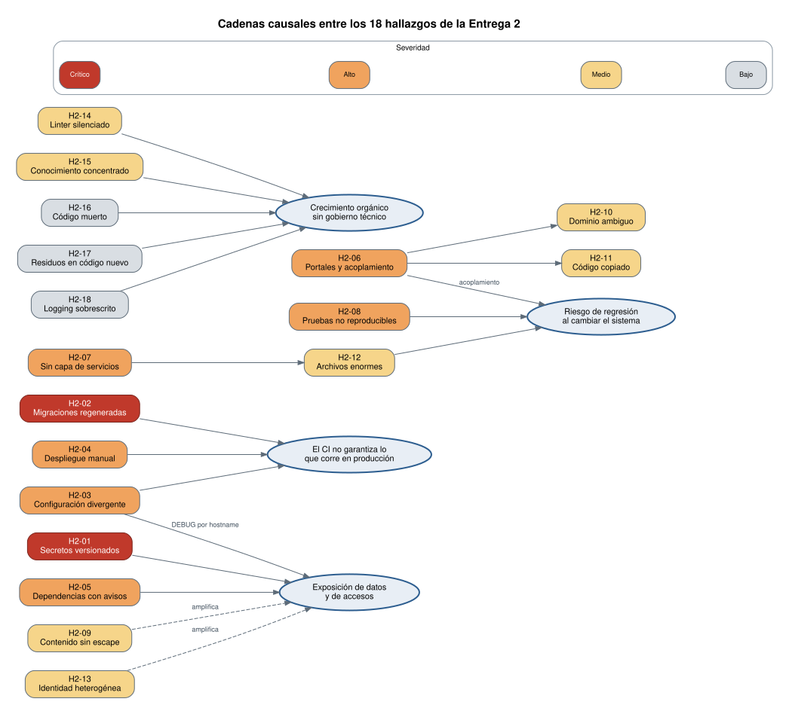

## 7.7 Registro consolidado de hallazgos

Se consolidaron **18 hallazgos priorizados**: **2 críticos, 6 altos, 7 medios y 3 bajos**. Sus relaciones de causalidad e impacto sistémico se ilustran en el diagrama causal (`../diagramas/05-causas.svg`).

### Tabla resumen por severidad

| ID | Título | Severidad | Bloque | Prioridad |
|---|---|---|---|---|
| **H2-01** | Secretos y contraseñas versionados en el repositorio | Crítico | Seguridad y secretos | Inmediata (P1) |
| **H2-02** | Migraciones no versionadas y regeneradas dinámicamente | Crítico | Operación | Inmediata (P1) |
| **H2-03** | Configuración divergente y activación de `DEBUG` por hostname | Alto | Operación / Seguridad | Alta (P2) |
| **H2-04** | Despliegue a producción manual sin automatización verificable | Alto | Operación | Alta (P2) |
| **H2-05** | Dependencias desactualizadas con vulnerabilidades conocidas (`Django 4.1.3`) | Alto | Seguridad y secretos | Alta (P2) |
| **H2-06** | Organización por portales y acoplamiento circular entre aplicaciones | Alto | Estructura y dominio | Alta (P2) |
| **H2-07** | Ausencia de capa de servicios y lógica de negocio en vistas | Alto | Estructura y dominio | Alta (P2) |
| **H2-08** | Suite de pruebas parcial en CI y no reproducible localmente por defecto | Alto | Calidad y personas | Alta (P2) |
| **H2-09** | Renderizado de HTML sin escape (`|safe` / `autoescape off`) y LaTeX sin auditar | Medio | Seguridad y secretos | Media (P3) |
| **H2-10** | Ambigüedad conceptual en el dominio (doble modelo `Ciclo` y flujos partidos) | Medio | Estructura y dominio | Media (P3) |
| **H2-11** | Duplicación masiva de lógica entre portales (`consejo_asesor.py`) | Medio | Estructura y dominio | Media (P3) |
| **H2-12** | Archivos monolíticos y funciones de alta complejidad ciclomática | Medio | Estructura y dominio | Media (P3) |
| **H2-13** | Sistemas de identidad y control de acceso heterogéneos | Medio | Seguridad y secretos | Media (P3) |
| **H2-14** | Silenciamiento sistemático del linter y `except:` sin tipo | Medio | Calidad y personas | Media (P3) |
| **H2-15** | Concentración de conocimiento en módulos críticos recientes | Medio | Calidad y personas | Media (P3) |
| **H2-16** | Código muerto comentado en módulos de trabajos finales (~1942 líneas) | Bajo | Calidad y personas | Baja (P4) |
| **H2-17** | Residuos de imports y variables sin usar en código nuevo (`flake8`) | Bajo | Calidad y personas | Baja (P4) |
| **H2-18** | Sobrescritura de configuración `LOGGING` fuera de producción | Bajo | Operación | Baja (P4) |

---

### Fichas técnicas detalladas

#### H2-01 · Secretos y contraseñas versionados en el repositorio
* **Severidad:** Crítico | **Prioridad de atención:** Inmediata (P1)
* **Descripción del problema:** Existen credenciales de servicios externos, tokens de CI y contraseñas de usuarios almacenados en texto claro dentro del código fuente y el historial de Git.
* **Evidencia encontrada:** Credenciales de correo electrónico e Imgur en `settings.py`, token en `.drone.yml` y archivo con 14 contraseñas de profesores en el repositorio (valores omitidos por seguridad).
* **Impacto técnico y riesgo asociado:** Compromiso directo de cuentas institucionales, servicios de correo/almacenamiento y acceso no autorizado a datos académicos si el repositorio es leído por terceros.
* **Recomendación inicial:** Revocar y rotar de inmediato todas las credenciales expuestas, migrar la configuración a variables de entorno (`.env` fuera de Git) y purgar los secretos del historial mediante `git filter-repo`.

#### H2-02 · Migraciones no versionadas y regeneradas dinámicamente
* **Severidad:** Crítico | **Prioridad de atención:** Inmediata (P1)
* **Descripción del problema:** Los archivos de migración de Django no se conservan bajo control de versiones; el sistema los borra y regenera desde cero en cada arranque y ejecución de CI.
* **Evidencia encontrada:** Script `migraciones.sh` y pasos de limpieza/regeneración en la configuración del entorno y pipeline CI.
* **Impacto técnico y riesgo asociado:** Imposibilidad de auditar cambios de esquema, ejecutar migraciones de datos personalizadas o realizar rollbacks seguros; alto riesgo de desincronización o pérdida de datos en producción.
* **Recomendación inicial:** Versionar el historial oficial de `migrations/` en Git, eliminar el borrado automático en `migraciones.sh` y validar `makemigrations --check --dry-run` en el CI.

#### H2-03 · Configuración divergente y activación de `DEBUG` por hostname
* **Severidad:** Alto | **Prioridad de atención:** Alta (P2)
* **Descripción del problema:** El proyecto mantiene dos archivos `settings.py` desincronizados y activa el modo producción únicamente si el nombre de red de la máquina es `faraday`. Además, el `requirements.txt` raíz apunta a un fork privado inaccesible.
* **Evidencia encontrada:** 16 diferencias entre ambos `settings.py`; condicional de `hostname == 'faraday'` para desactivar `DEBUG`; referencia rota en `requirements.txt` raíz.
* **Impacto técnico y riesgo asociado:** Despliegues en nuevos servidores o contenedores arrancan con `DEBUG = True`, exponiendo variables de entorno y trazas internas; el CI prueba una configuración distinta a la real.
* **Recomendación inicial:** Unificar `settings` en un paquete modular (`base.py`, `dev.py`, `prod.py`) gobernado por variables de entorno explícitas (`DJANGO_DEBUG`) y consolidar un único `requirements.txt` reproducible.

#### H2-04 · Despliegue a producción manual sin automatización verificable
* **Severidad:** Alto | **Prioridad de atención:** Alta (P2)
* **Descripción del problema:** El pipeline de integración continua no ejecuta pasos reales de entrega ni verificación post-despliegue hacia el servidor productivo.
* **Evidencia encontrada:** Etapa de despliegue en `.drone.yml` limitada a ejecutar `git status`.
* **Impacto técnico y riesgo asociado:** Dependencia de intervención manual propensa a error humano, deriva de configuración entre commits auditados y código en ejecución, y ausencia de rollback automatizado.
* **Recomendación inicial:** Documentar el procedimiento actual de actualización en `faraday` y automatizar un pipeline reproducible con verificación de salud (*healthcheck*) tras el despliegue.

#### H2-05 · Dependencias desactualizadas con vulnerabilidades conocidas
* **Severidad:** Alto | **Prioridad de atención:** Alta (P2)
* **Descripción del problema:** El sistema utiliza versiones de framework y librerías que ya no reciben parches de seguridad y mantiene paquetes sin uso en el entorno.
* **Evidencia encontrada:** Consulta a OSV sobre dependencias: `Django 4.1.3` (EOL, 30 avisos OSV), `Pillow` (87 avisos OSV) y `PyPDF2` (4 avisos OSV, sin ningún `import` en el código fuente).
* **Impacto técnico y riesgo asociado:** Exposición a vulnerabilidades públicamente documentadas en procesamiento de imágenes y manejo de peticiones HTTP/ORM.
* **Recomendación inicial:** Retirar `PyPDF2` de inmediato, actualizar `Pillow` y planificar la migración incremental de `Django 4.1.3` hacia una versión LTS vigente (`4.2 LTS` o `5.2 LTS`).

#### H2-06 · Organización por portales y acoplamiento circular entre aplicaciones
* **Severidad:** Alto | **Prioridad de atención:** Alta (P2)
* **Descripción del problema:** Las aplicaciones Django están divididas por tipo de usuario (`administrativos`, `profesores`, `estudiantes`) en lugar de subdominios de negocio, obligando a importar modelos y utilidades en todas direcciones.
* **Evidencia encontrada:** `administrativos` es importado por 16 de 20 apps (E-032, E-054); `profesores` importa 12 apps (22 imports de `administrativos`); herencia `Profesor(Funcionario)` cruza fronteras de app (E-061).
* **Impacto técnico y riesgo asociado:** Alto costo de cambio y efecto dominó: modificar entidades base como `Ciclo` o `Funcionario` impacta prácticamente todo el sistema.
* **Recomendación inicial:** Extraer las entidades transversales (`Ciclo`, `Funcionario`, `Roles`, `Comision`, `Lugar`) a una app de dominio puro (`nucleo`) sin vistas, manteniendo re-exportaciones temporales para migrar gradualmente.

#### H2-07 · Ausencia de capa de servicios y lógica de negocio en vistas
* **Severidad:** Alto | **Prioridad de atención:** Alta (P2)
* **Descripción del problema:** Las funciones y clases de vista concentran consultas ORM complejas, reglas de negocio, generación de archivos y envío de notificaciones.
* **Evidencia encontrada:** Entre 42 % y 82 % de llamadas `.objects.` dentro de `views` en 5 de 6 módulos auditados (`77/94` en `firma_digital`, `136/202` en `profesores`, `55/132` en `administrativos`, `44/73` en `estudiantes`, `34/56` en `trabajo_final_de_graduacion`).
* **Impacto técnico y riesgo asociado:** Imposibilidad de reutilizar operaciones de negocio entre portales sin copiar código y dificultad para escribir pruebas unitarias rápidas sin levantar contexto HTTP.
* **Recomendación inicial:** Introducir módulos `services.py` por dominio para encapsular transacciones ORM y reglas de negocio, dejando las vistas limitadas a validación de entrada y respuesta HTTP.

#### H2-08 · Suite de pruebas parcial en CI y no reproducible localmente por defecto
* **Severidad:** Alto | **Prioridad de atención:** Alta (P2)
* **Descripción del problema:** Aunque existen 1165 pruebas, el CI omite casi la mitad de las aplicaciones, no mide cobertura y la ejecución local falla sin ajustes manuales de permisos en base de datos.
* **Evidencia encontrada:** CI ejecuta 11 de 21 apps; fallo local por `acceso denegado a test_info`; baja densidad en `estudiantes` (0.9 pruebas/100 LOC) y `trabajos_finales` (0.2 pruebas/100 LOC).
* **Impacto técnico y riesgo asociado:** Falsa sensación de seguridad: regresiones en módulos centrales o desatendidos pasan desapercibidas hasta llegar a producción.
* **Recomendación inicial:** Incorporar las 21 apps al CI con reporte de cobertura mínima, documentar el setup de BD de pruebas (o usar SQLite/contenedor efímero en CI) y priorizar pruebas de caracterización en `estudiantes`.

#### H2-09 · Renderizado de HTML sin escape y generación LaTeX por auditar
* **Severidad:** Medio | **Prioridad de atención:** Media (P3)
* **Descripción del problema:** Se desactiva el escape automático de Django en varias plantillas y se construyen documentos PDF vía LaTeX con entradas de usuario.
* **Evidencia encontrada:** ~9 plantillas con `autoescape off` o `|safe`; 3 usos de `mark_safe` y 1 `urlopen` en `bandit`; flujos de `GenerarLaTeX` en módulos de trámites y TFG.
* **Impacto técnico y riesgo asociado:** Riesgo medio y condicionado de XSS almacenado (mitigado parcialmente por tratarse de usuarios internos) y posible inyección de comandos/fallos de compilación en LaTeX.
* **Recomendación inicial:** Sustituir `|safe` por sanitización explícita (`bleach` o formateo estructurado) y verificar el escapado de caracteres especiales (`\`, `$`, `%`, `{`, `}`) antes de compilar LaTeX.

#### H2-10 · Ambigüedad conceptual en el dominio (doble modelo `Ciclo` y flujos partidos)
* **Severidad:** Medio | **Prioridad de atención:** Media (P3)
* **Descripción del problema:** Existen dos entidades distintas nombradas `Ciclo`, dos estructuras paralelas de trabajos finales y trámites administrativos divididos entre aplicaciones.
* **Evidencia encontrada:** `Ciclo` en `administrativos` vs `Ciclo` en `cursos/models.py:834` con alias `AdminCiclo` en línea 12 (E-065, E-074); `trabajos_finales` vs `trabajo_final_de_graduacion` (E-066); `CambioEnfasis` y `ConfirmarCambioEnfasis` (E-068).
* **Impacto técnico y riesgo asociado:** Errores de importación silenciosos dentro de `cursos/models.py` según la línea del archivo y confusión al extender el modelo de datos.
* **Recomendación inicial:** Renombrar el modelo de `cursos` a `CicloPlanEstudio` y documentar explícitamente la frontera entre `ProyectoElectrico` (modalidad anterior) y `TFG` (modalidad 2025).

#### H2-11 · Duplicación masiva de lógica entre portales (`consejo_asesor.py`)
* **Severidad:** Medio | **Prioridad de atención:** Media (P3)
* **Descripción del problema:** Operaciones completas del consejo asesor fueron copiadas y pegadas entre los portales de administrativos y profesores.
* **Evidencia encontrada:** 8 funciones compartidas en `administrativos/views/consejo_asesor.py` y `profesores/views/consejo_asesor.py` (348 de 437 líneas, similitud 0.95–1.0), con `resumen_ciclo` (158 líneas, CC 25) idéntica (E-071, E-077).
* **Impacto técnico y riesgo asociado:** Divergencia funcional ante correcciones de errores y duplicación del esfuerzo de mantenimiento.
* **Recomendación inicial:** Extraer la lógica común del consejo asesor a un servicio compartido y parametrizar únicamente las diferencias de plantilla o permisos por portal.

#### H2-12 · Archivos monolíticos y funciones de alta complejidad ciclomática
* **Severidad:** Medio | **Prioridad de atención:** Media (P3)
* **Descripción del problema:** Múltiples archivos superan las 1300–2900 líneas y contienen funciones con más de 20–30 caminos de ejecución.
* **Evidencia encontrada:** `firma_digital/views.py` (2918 líneas, 17 bloques CC ≥ C), `profesores/views/consejo_asesor.py` (2117 líneas, `editar_grupo` CC 33), `trabajo_final_de_graduacion/views.py` (1352 líneas, `enviar_revision_propuesta_tfg` CC 29), `estudiantes/models.py` (1347 líneas, E-067).
* **Impacto técnico y riesgo asociado:** Alta carga cognitiva para nuevos desarrolladores, conflictos frecuentes de fusión en Git y mayor probabilidad de introducir defectos al modificar ramas condicionales.
* **Recomendación inicial:** Dividir los archivos grandes por caso de uso (paquetes `views/` y `models/`) y refactorizar funciones de rango D/E tras cubrirlas con pruebas de caracterización.

#### H2-13 · Sistemas de identidad y control de acceso heterogéneos
* **Severidad:** Medio | **Prioridad de atención:** Media (P3)
* **Descripción del problema:** Coexisten dos modelos de autenticación (Django `User` para funcionarios y contraseña propia en `Estudiante`) y múltiples convenciones incompatibles de autorización.
* **Evidencia encontrada:** `Estudiante.SetPassword` con `uuid4` + `PBKDF2-SHA256` y modelos propios de recuperación (E-070, E-079); ~20 decoradores propios con alias confusos (`@login_required` en `gestion_inventario.py:15-16`, E-060) frente a `LoginRequiredMixin` en `firma_digital` (E-063).
* **Impacto técnico y riesgo asociado:** Superficie duplicada de mantenimiento en flujos críticos de sesión y riesgo de omitir validaciones de rol por confusión de alias.
* **Recomendación inicial:** Estandarizar los decoradores/mixins de autorización con nombres explícitos de rol y evaluar la unificación gradual de `Estudiante` bajo el backend de autenticación de Django.

#### H2-14 · Silenciamiento sistemático del linter y `except:` sin tipo
* **Severidad:** Medio | **Prioridad de atención:** Media (P3)
* **Descripción del problema:** En lugar de corregir excepciones genéricas o advertencias de calidad, se desactivan mediante comentarios `# noqa` o exclusiones globales en `.flake8`.
* **Evidencia encontrada:** 52 `except:` sin tipo fuera de pruebas (42 con `# noqa`, 7 reportados, 3 en `scripts/` excluido en `.flake8`, E-053); fallo oculto de `get_profile_media` en `administrativos/templatetags/misc_tags.py:121-123` (E-062).
* **Impacto técnico y riesgo asociado:** Enmascaramiento de errores reales en tiempo de ejecución (`NameError`, errores de red o integridad) que pasan silenciosamente como listas vacías.
* **Recomendación inicial:** Eliminar los `# noqa` sobre `E722`, capturar excepciones específicas con registro en bitácora y habilitar `W605` en `.flake8`.

#### H2-15 · Concentración de conocimiento en módulos críticos recientes
* **Severidad:** Medio | **Prioridad de atención:** Media (P3)
* **Descripción del problema:** Los módulos incorporados en 2025 presentan un factor de bus (*bus factor*) muy reducido en comparación con las aplicaciones históricas.
* **Evidencia encontrada:** Historial Git: `firma_digital` (10 175 LOC) desarrollado por 2 autores; `trabajo_final_de_graduacion` (3968 LOC) por 4 autores, frente a 18–24 autores en los módulos base.
* **Impacto técnico y riesgo asociado:** Riesgo operativo de pérdida de conocimiento institucional si los desarrolladores recientes dejan el proyecto sin documentación técnica ni revisiones cruzadas.
* **Recomendación inicial:** Exigir revisiones de código cruzadas (*pull requests*) y documentar los flujos clave de integración (como el protocolo local con Firmador Libre en puerto 3516, E-044).

#### H2-16 · Código muerto comentado en módulos de trabajos finales
* **Severidad:** Bajo | **Prioridad de atención:** Baja (P4)
* **Descripción del problema:** Se conservan bloques extensos de la antigua implementación de TFG comentados con `##` dentro de archivos activos.
* **Evidencia encontrada:** ~1942 líneas comentadas en 8 archivos, incluyendo 685 de 1313 líneas en `trabajos_finales/models.py` y 475 de 978 en `profesores/views/trabajos_finales.py` (E-072, E-075, E-076).
* **Impacto técnico y riesgo asociado:** Contaminación de búsquedas en el código, distorsión de métricas estáticas (como `CitaPresentacion`, E-078) y 1648 avisos `E266` en `flake8`.
* **Recomendación inicial:** Eliminar todo el código comentado respaldado por el historial de Git.

#### H2-17 · Residuos de imports y variables sin usar en código nuevo
* **Severidad:** Bajo | **Prioridad de atención:** Baja (P4)
* **Descripción del problema:** El módulo `trabajo_final_de_graduacion` contiene numerosos imports duplicados o sin utilizar que degradan la limpieza del código.
* **Evidencia encontrada:** 56 avisos `flake8` en `trabajo_final_de_graduacion` (35 `F401`, 16 `F811` en `forms.py:3-7, 426`, 4 `F841`, 1 `F541`, E-073, E-079).
* **Impacto técnico y riesgo asociado:** Ruido en herramientas de análisis estático y riesgo de sombreado accidental de símbolos importados.
* **Recomendación inicial:** Ejecutar limpieza automática de imports (`autoflake` / `ruff`) e integrar verificación `flake8` estricta en el CI.

#### H2-18 · Sobrescritura de configuración `LOGGING` fuera de producción
* **Severidad:** Bajo | **Prioridad de atención:** Baja (P4)
* **Descripción del problema:** En entornos distintos a producción, una segunda asignación de `LOGGING` reemplaza la configuración base y elimina el registro persistente en archivos.
* **Evidencia encontrada:** Segunda definición del diccionario `LOGGING` en `settings.py` condicionada al entorno no productivo.
* **Impacto técnico y riesgo asociado:** Pérdida de trazabilidad al depurar errores en entornos de pruebas o staging si no se captura la salida estándar.
* **Recomendación inicial:** Unificar la configuración de `LOGGING` ajustando únicamente los niveles de verbosidad (`INFO`/`DEBUG`) por variable de entorno sin destruir los *handlers* configurados.
