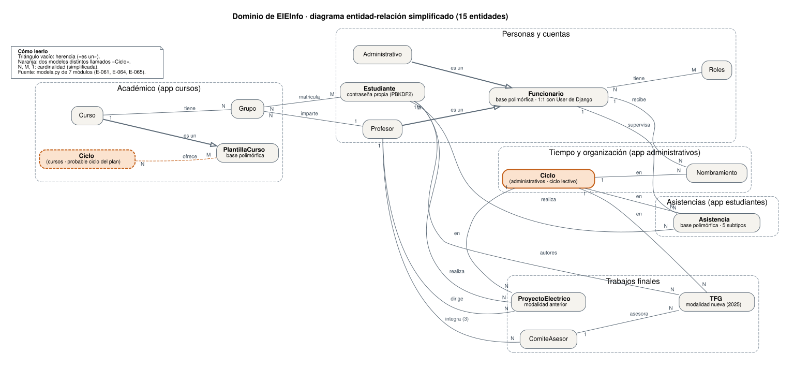
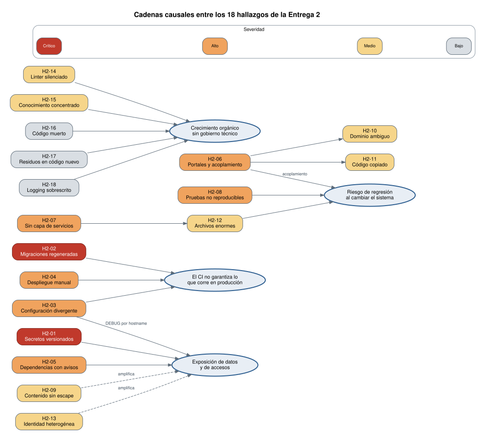

# Auditoría de diseño de software del sistema EIEInfo
## Entrega 2: Auditoría profunda de diseño, calidad y riesgos

- **Curso:** IE0417 – Diseño de Software para Ingeniería
- **Estudiante:** Gabriel Gustavo Ulloa Bermúdez, C27890
- **Fecha:** 17/11/2026
- **Repositorio auditado:** https://github.com/EIE-UCR/eieinfo — **commit:** `d7c8c1b56b0e17a3d53af74dff1487c2f3577422` (14/10/2026)

> Convenciones: `E-xxx` remite al registro de evidencia (`docs/anexos/evidencia.md`); `H2-xx` son los hallazgos de esta entrega (los `H-xx` son los de la Entrega 1); ⏳ marca una verificación pendiente. En este informe **no se reproducen valores de credenciales**.

**Contenido:** Resumen ejecutivo · 1 Método y alcance · 2 Atributos de calidad (7.1) · 3 Auditoría modular (7.2) · 4 Dominio (7.3) · 5 Calidad del código (7.4) · 6 Pruebas y confiabilidad (7.5) · 7 Seguridad y operación (7.6) · 8 Registro de hallazgos (7.7) · 9 Preguntas orientadoras · 10 Límites · 11 Conclusiones · Anexos

---

## Resumen ejecutivo

La Entrega 2 profundiza el diagnóstico de la Entrega 1 con métricas estáticas, la lectura de seis módulos, la reconstrucción del dominio (102 modelos), la inspección de pruebas, seguridad y operación, y la consolidación de **18 hallazgos** (2 críticos, 6 altos, 7 medios y 3 bajos; 12 sistémicos y 6 locales).

Tres ideas resumen el diagnóstico:

1. **Lo más grave está en la operación, no en la lógica de negocio:** secretos y credenciales versionados, migraciones regeneradas en cada arranque, configuración divergente entre entornos y despliegue manual.
2. **La organización por portales de usuario explica gran parte de los problemas de diseño:** el acoplamiento circular (16 de las otras 20 apps dependen de `administrativos`), el código copiado entre portales (348 de las 437 líneas del archivo del consejo asesor de `administrativos`) y la ambigüedad del dominio (dos modelos `Ciclo`).
3. **El código reciente (2025) muestra mejores hábitos, pero repite el problema del tamaño:** `firma_digital` está aislada y tiene 456 pruebas autosuficientes, pero concentra su lógica en un archivo de 2918 líneas.

Las cifras proceden de herramientas estáticas y de una ejecución local en Docker; **no se midió la cobertura real**. Los límites se detallan en la sección 10.

## 1. Método y alcance

**Trabajo realizado.** (a) Cierre de los pendientes de la Entrega 1; (b) métricas globales de complejidad, estilo y vulnerabilidades; (c) un script de solo lectura (`modulo.sh`) aplicado a seis módulos; (d) lectura de los modelos de siete módulos; (e) inspección de pruebas, seguridad y operación; (f) consolidación en un registro de hallazgos con relaciones causales.

| Herramienta | Uso |
|---|---|
| `modulo.sh` (propio) | Ficha de datos por módulo: tamaño, historial, dependencias, señales de mezcla de responsabilidades, pruebas |
| `radon` | Complejidad ciclomática |
| `flake8` | Estilo y errores simples (con la configuración `.flake8` del proyecto) |
| `bandit` | Patrones inseguros en el código |
| API de OSV | Vulnerabilidades conocidas de los paquetes instalados en el contenedor |
| `difflib` | Similitud textual entre funciones |
| `grep`, `awk`, `git` | Búsquedas, relaciones entre modelos e historial |

**Criterio de selección de módulos:** dependencia entrante, volumen de código, actividad reciente y complejidad (sección 3.1).

**Correcciones durante el proceso.** Varias lecturas iniciales se corrigieron al verificarlas, lo que se documenta por transparencia: el CI sí existe (`.drone.yml`); `run-ut.sh` es un script local desactualizado y el CI prueba 11 apps; los ajustes de `firma_digital` que parecían ausentes en la configuración del CI son ajustes huérfanos que ningún código lee; los conteos con líneas comentadas inflaban varias cifras (las «dos claves a `TrabajoFinalGraduacion`» y los «usos de `@tfg_login_required`» eran código comentado); `PyPDF2` figura en las dependencias pero no se importa en ningún archivo.

## 2. Evaluación por atributos de calidad (7.1)

El sistema muestra un contraste marcado entre los módulos de 2016-2017 y los de 2025.

| Atributo | Fortalezas observadas | Debilidades observadas | Evidencia y módulos que lo ilustran |
|---|---|---|---|
| **Mantenibilidad** | Los módulos de 2025 no tienen `except:` sin tipo; `firma_digital` tiene una suite amplia | Archivos de 2918 y 2117 líneas; 12 funciones de complejidad D o E (`editar_grupo` 33, `enviar_email` 39); ≈1942 líneas comentadas | E-005, E-038, E-056, E-076 · `firma_digital`, `profesores`, `trabajos_finales` |
| **Modificabilidad** | `firma_digital` es un módulo aislado (nadie lo importa) | `administrativos` lo importan 16 apps; más de 25 pares con dependencia mutua; `Profesor` hereda de `Funcionario` entre apps | E-019, E-054, E-061, E-064 · `administrativos`, `profesores` |
| **Cohesión** | `firma_digital` concentra una responsabilidad clara (la firma de documentos) | `administrativos` es portal y núcleo a la vez; `estudiantes/models.py` mezcla cuatro subdominios; `profesores` aloja la interfaz de TFG y proyecto eléctrico | E-054, E-055, E-067 · `administrativos`, `estudiantes` |
| **Acoplamiento** | `firma_digital` depende solo de dos apps (fan-out 2) | Herencia polimórfica entre apps; utilidades compartidas alojadas en `webpage` y `eieinfo`; importación directa de `eieinfo.settings` | E-019, E-027, E-061 · `profesores`, `administrativos` |
| **Testabilidad** | 1165 pruebas y ninguna saltada; 456 pruebas autosuficientes en `firma_digital`; una prueba exige el token CSRF | 38 usos de fixtures generadas con `dumpdata`; la suite local falla por permisos (error 1044); cobertura baja en `estudiantes` (0,9 pruebas por 100 líneas) y `trabajos_finales` (0,2); el CI cubre 11 de 21 apps | E-009, E-016, E-056, E-057, E-059, E-087 |
| **Seguridad básica** | Contraseñas de estudiantes con PBKDF2 y sal aleatoria; `/media/tfg/` denegado en nginx; `bandit` sin hallazgos altos | Secretos versionados; modo producción decidido por el nombre de la máquina; 143 avisos de vulnerabilidad en 9 paquetes; contenido sin escape en al menos 9 plantillas (⏳) | E-010, E-011, E-012, E-037, E-079, E-082, E-085, E-086 |
| **Consistencia arquitectónica** | Las apps siguen la estructura base de Django (models, views, forms, urls) | Dos convenciones de acceso (decoradores con alias frente a mixins); imports relativos y absolutos mezclados; dos modelos `Ciclo`; tres apps sin montar; `views/` y `my_views/` | E-018, E-050, E-060, E-063, E-065 |
| **Observabilidad operativa** | Registros en archivos en producción (`/var/info/logs`); el CI notifica por Telegram y correo; la base de datos tiene comprobación de estado | Un segundo `LOGGING` sobrescribe al primero fuera de producción; 17 `print()` fuera de pruebas; 52 `except:` sin tipo ocultan errores; no se observa monitoreo de la aplicación (⏳) | E-009, E-039, E-053, E-088 |

## 3. Auditoría modular (7.2)

### 3.1 Selección de módulos

| Módulo | Por qué entra en la auditoría |
|---|---|
| `administrativos` | Lo importan 16 apps; aloja `Ciclo`, `Roles` y `Funcionario`; `resumen_ciclo` duplicada |
| `profesores` | Mayor fan-out (12 apps), 138 vistas, 11 roles, la función más compleja de las vistas (`editar_grupo`, CC 33) |
| `firma_digital` | Módulo más reciente y de mayor actividad; vistas de 2918 líneas sin `forms.py` |
| `estudiantes` | Modelo más grande (1347 líneas) con pocas pruebas |
| `trabajo_final_de_graduacion` | Código nuevo con dos funciones de rango D y dominio solapado con `trabajos_finales` |
| `trabajos_finales` | Casi dormido, con 1313 líneas de modelos y 5 pruebas |

### 3.2 Comparativa de los seis módulos

| | administrativos | profesores | firma_digital | estudiantes | trabajo_final_de_graduacion | trabajos_finales |
|---|---:|---:|---:|---:|---:|---:|
| Líneas de Python (con pruebas) | 8009 | 11 332 | 10 175 | 4551 | 3968 | 2861 |
| Primer commit | 2017 | 2016 | 2025 | 2016 | 2025 | 2017 |
| Commits en 12 meses | 38 | 58 | 47 | 22 | 13 | 3 |
| Autores distintos | 24 | 24 | 2 | 18 | 4 | 11 |
| Modelos (mínimo)¹ | 16 | 1 | 8 | 10 | 8 | 6 |
| Vistas | 89 | 138 | 30 | 36 | 26 | 3 |
| Apps que lo importan (fan-in) | **16** | 10 | 0 | 10 | 2 | 4 |
| Apps que importa (fan-out)² | 9 | **12** | 2 | 10 | 5 | 6 |
| Consultas ORM dentro de vistas⁴ | 55 de 132 | 136 de 202 | 77 de 94 | 44 de 73 | 34 de 56 | 3 de 46 |
| Pruebas (`test_`) | 87 | 211 | 456 | 36 | 74 | 5 |
| Pruebas por 100 líneas de código³ | 1.4 | 2.8 | **11.3** | 0.9 | 2.8 | 0.2 |
| `except:` sin tipo⁴ | 14 | 12 | 0 | 9 | 0 | 0 |
| Funciones de complejidad C o peor | 3 | 14 | 17 | 0 | 5 | 0 |
| Avisos flake8 (F y E722) | 14 | 10 | 0 | 4 | **56** | 3 |

¹ La búsqueda solo cuenta clases que heredan directamente de `Model`; subestima las que heredan de otra clase de dominio (por ejemplo, las de `profesores`). Se corrige en la auditoría del dominio.

² Sin contar `eieinfo`.

³ Aproximado: funciones `test_` divididas entre las líneas de código sin el archivo de pruebas.

⁴ Los conteos de consultas ORM y de `except:` salen de la versión de `modulo.sh` que no excluía líneas comentadas; se recalculan con la versión nueva (⏳, ver límites).

### 3.3 Fichas por módulo

#### 3.3.1 `administrativos`

| Campo | Contenido |
|---|---|
| **Responsabilidad principal** | Portal del personal administrativo: ciclos lectivos, consejo asesor, estudiantes, noticias, inventario, reservaciones, práctica profesional y delegación de dirección (`administrativos/urls.py`) |
| **Responsabilidades reales** | Además de su portal, aloja conceptos centrales que usan 16 apps (`Ciclo`, `Roles`, `Funcionario`, `Comision`, `Lugar`, `AREAS_UCR`), utilidades de contexto y de roles (`CrearContextoAdministrativo`, `ObtenerRolesFuncionario`), reportes Excel (`reportes.py`) y envío de correo. Es a la vez portal y núcleo del dominio (E-032, E-054) |
| **Dependencias relevantes** | Entrada: 16 apps (`profesores` 22 imports, `trabajo_final_de_graduacion` 7, `estudiantes` 7, `cursos` 6). Salida: 9 apps (`cursos` 10, `profesores` 8, `estudiantes` 7) |
| **Fortalezas** | 87 pruebas (1853 líneas) sin saltos; solo 3 funciones de complejidad alta; roles con decoradores nombrados; historial continuo desde 2017 |
| **Debilidades** | Doble papel (portal y núcleo); 55 de 132 consultas ORM dentro de vistas; 14 `except:` sin tipo (12 silenciados con `# noqa`; 2 en `misc_tags.py`, donde `get_profile_media` no está definida y su error queda oculto, de modo que el muro de Instagram siempre sale vacío (E-062)); 8 funciones de `views/consejo_asesor.py` copiadas casi tal cual en `profesores` (348 de sus 437 líneas, similitud de 0.95 a 1.0); la mayor, `resumen_ciclo` (158 líneas, CC 25), es idéntica (E-077); el alias `@login_required` de `gestion_inventario.py` es en realidad el rol de inventario (E-060) |
| **Riesgos de cambio** | Muy alto. Un cambio en `Ciclo`, `Roles` o `Funcionario` afecta a 16 apps, y hay dependencias circulares con `profesores`, `estudiantes` y `cursos` |
| **Recomendaciones puntuales** | 1) Mover `Ciclo`, `Roles`, `Funcionario`, `Comision` y `Lugar` a un módulo común sin vistas, dejando `administrativos` solo como portal. 2) Unificar `resumen_ciclo` en una sola implementación. 3) Reemplazar los 14 `except:` por tipos concretos, empezando por `misc_tags.py`. 4) Renombrar el alias `login_required` al nombre real del rol |

#### 3.3.2 `profesores`

| Campo | Contenido |
|---|---|
| **Responsabilidad principal** | Portal de profesores: nombramientos, cursos, asistencias, consejo asesor, comisiones, laboratorios, proyectos, publicaciones, práctica profesional y proyecto eléctrico (`profesores/urls.py`) |
| **Responsabilidades reales** | Además aloja la interfaz de trabajos finales y proyecto eléctrico (`views/trabajos_finales.py`, 978 líneas), la planificación de grupos y horarios (`consejo_asesor.py`, 2117 líneas), reservas de instalaciones y 11 decoradores de rol en `misc.py`. Su modelo propio es mínimo (⏳ confirmar herencia de `administrativos` en la Parte 3) |
| **Dependencias relevantes** | Salida: 12 apps (`administrativos` 22, `cursos` 13, `proyectos` 10, `estudiantes` 8). Entrada: 10 apps (`administrativos` 8, `trabajo_final_de_graduacion` 7, `atributos` 4) |
| **Fortalezas** | Módulo más activo (58 commits en 12 meses); 211 pruebas; control de acceso explícito con 11 niveles de rol |
| **Debilidades** | Mayor fan-out del sistema; 136 de 202 consultas ORM dentro de vistas (67 %); `editar_grupo` (CC 33), `resumen_ciclo` (CC 25) y `CrearContextoProfesor` (CC 23); 12 `except:` sin tipo; mezcla de dominios ajenos (TFG y proyecto eléctrico); 475 de las 978 líneas de `views/trabajos_finales.py` están comentadas (código de TFG retirado; E-072, E-076) |
| **Riesgos de cambio** | Alto. Los cambios en `administrativos`, `cursos` o `proyectos` repercuten aquí, y refactorizar `consejo_asesor.py` sin pruebas por función es arriesgado |
| **Recomendaciones puntuales** | 1) Dividir `consejo_asesor.py` por caso de uso (grupos, horarios, resumen de ciclo). 2) Descomponer `editar_grupo` hasta bajar de CC 15, con pruebas de caracterización antes de tocarla. 3) Mover la interfaz de TFG y proyecto eléctrico a los módulos dueños de ese dominio. 4) Eliminar el código comentado de TFG en `views/trabajos_finales.py` |

#### 3.3.3 `firma_digital`

| Campo | Contenido |
|---|---|
| **Responsabilidad principal** | Firma digital de documentos PDF: solicitudes, firma en lote, descarga y subida de documentos firmados, con el cliente local Firmador Libre |
| **Responsabilidades reales** | Acceso a datos desde las vistas (77 de 94 consultas ORM), generación y emparejamiento de PDF (`_crear_pdf_desde_archivo`, `_emparejar_firmado`), descargas ZIP, API AJAX, 7 archivos JS propios y el puerto 3516 fijo en el cliente (E-044) |
| **Dependencias relevantes** | Salida mínima (`administrativos` 4, `profesores` 3). Entrada: ninguna, nadie la importa |
| **Fortalezas** | Módulo aislado; 456 pruebas sin fixtures (autosuficientes); 0 `except:` y 0 avisos de flake8; una prueba verifica que el callback del firmador exija el token CSRF (E-063); código reciente (desde 2025-09) |
| **Debilidades** | `views.py` de 2918 líneas en un solo archivo y sin `forms.py`; 82 % del ORM dentro de vistas; 17 bloques de complejidad alta (3 de rango D); solo 2 autores; usa `LoginRequiredMixin` de Django y un mixin propio en lugar de los decoradores del proyecto, una convención distinta (E-063; ⏳ confirmar qué roles exige cada vista) |
| **Riesgos de cambio** | Medio. Está aislado, pero el conocimiento está en 2 personas y en un único archivo grande |
| **Recomendaciones puntuales** | 1) Dividir `views.py` por flujo (solicitudes, descarga, subida). 2) Mover las consultas a una capa de servicios. 3) Documentar y verificar el control de acceso. 4) Tomarlo como modelo de pruebas autosuficientes para el resto del sistema |

#### 3.3.4 `estudiantes`

| Campo | Contenido |
|---|---|
| **Responsabilidad principal** | Portal de estudiantes: cursos, asistencias, trámites, proyecto eléctrico, bodega, práctica profesional y ofertas |
| **Responsabilidades reales** | `models.py` de 1347 líneas (el mayor del sistema, 10 modelos), envío de correo (28 referencias), formularios con 9 escapes inválidos (E-042) y la interfaz de trabajos finales (`views/trabajos_finales.py`, 414 líneas) |
| **Dependencias relevantes** | Salida: 10 apps (`administrativos` 7, `webpage` 6, `cursos` 6). Entrada: 10 apps (`profesores` 8, `administrativos` 7, `trabajo_final_de_graduacion` 5) |
| **Fortalezas** | Sin funciones de complejidad alta; pocos avisos (4); acceso con un solo decorador coherente (32 usos); actividad sostenida (22 commits en 12 meses) |
| **Debilidades** | Cobertura baja: 36 pruebas para ≈4100 líneas (0.9 por 100); 44 de 73 consultas ORM dentro de vistas (60 %); 9 `except:` sin tipo (8 con `# noqa`); un modelo de 1347 líneas con cuatro subdominios mezclados; contraseñas propias (campo `contraseña` y `SetPassword` en `Estudiante`, con sal aleatoria y PBKDF2, lo cual es correcto), separadas del `User` de Django (E-070) |
| **Riesgos de cambio** | Alto. Lo usan `profesores`, `administrativos` y `trabajo_final_de_graduacion`, y tiene pocas pruebas |
| **Recomendaciones puntuales** | 1) Pruebas con prioridad en `models.py`. 2) Aislar el envío de correo en un servicio. 3) Sustituir los 9 `except:`. 4) Dividir `models.py` por subdominios, tras la Parte 3 |

#### 3.3.5 `trabajo_final_de_graduacion`

| Campo | Contenido |
|---|---|
| **Responsabilidad principal** | Proceso del trabajo final de graduación: propuestas, revisores y pareceres de comisión |
| **Responsabilidades reales** | 26 vistas-función con la lógica del flujo dentro (34 de 56 consultas ORM en vistas), generación de LaTeX o PDF (3 referencias), correo (5) y Excel (4); carga previa de datos en `precarga.py` |
| **Dependencias relevantes** | Salida: 5 apps (`profesores` 7, `administrativos` 7, `estudiantes` 5). Entrada: 2 (`profesores` 1, `estudiantes` 1) |
| **Fortalezas** | Código reciente (desde 2025-03) con 0 `except:` y 0 `# noqa`; 74 pruebas; bajo fan-in; roles específicos (comisión y revisor) |
| **Debilidades** | 56 avisos de flake8, el máximo de los seis, pero casi todos son residuos: 35 imports sin usar, 16 imports repetidos o redefinidos (líneas 3 a 7 de `forms.py`), 4 variables sin usar y 1 f-string sin campos (E-073); dos funciones de rango D (`enviar_revision_propuesta_tfg` CC 29, `parecer_comision_unificado` CC 21); fuerte dependencia de `profesores` y `administrativos`; vistas de 1352 líneas; solo 4 autores |
| **Riesgos de cambio** | Medio. Lo usan pocos, pero cualquier cambio en `Funcionario` o `Roles` lo afecta |
| **Recomendaciones puntuales** | 1) Limpiar los 56 avisos (casi todos imports sin usar). 2) Descomponer `enviar_revision_propuesta_tfg`. 3) Definir una interfaz estable con `profesores` en lugar de 14 imports directos. 4) Aclarar su relación con `trabajos_finales` (ficha siguiente) |

#### 3.3.6 `trabajos_finales`

| Campo | Contenido |
|---|---|
| **Responsabilidad principal** | Modelos, formularios y reportes de trabajos finales y proyectos eléctricos (módulo desde 2017) |
| **Responsabilidades reales** | Funciona como biblioteca de dominio: 6 modelos en 1313 líneas, formularios de 1056 y 20 referencias a correo. Casi no tiene vistas (3 en 113 líneas): la interfaz vive en `profesores` y `estudiantes`. Su decorador `pe_login_required` lo usan las vistas de `profesores` |
| **Dependencias relevantes** | Entrada: 4 apps (`profesores` 4, `estudiantes` 3, `webpage` 1, `proyecto_electrico` 1). Salida: 6 apps |
| **Fortalezas** | Lógica de datos fuera de las vistas (3 de 46 consultas ORM); 0 `except:` y 0 `# noqa`; solo 3 avisos; sin funciones de complejidad alta |
| **Debilidades** | Casi inactivo (3 commits en 12 meses); 5 pruebas para ≈2800 líneas, casi la mitad de ellas código comentado (0.2 por 100 sobre el total); `models.py` de 1313 líneas, de las que 685 (52 %) son código comentado (la antigua `TrabajoFinalGraduacion`, desde la línea 706; E-075, E-076); fuera del CI; dominio solapado con `trabajo_final_de_graduacion` y rutas antiguas de TFG desactivadas en el código y en el pipeline |
| **Riesgos de cambio** | Alto por falta de pruebas, aunque cambie poco: quien lo toque no tiene red de seguridad |
| **Recomendaciones puntuales** | 1) Decidir su destino: retirar lo que ya reemplazó `trabajo_final_de_graduacion` o formalizarlo como núcleo del dominio. 2) Si se conserva, pruebas mínimas para sus 6 modelos e incorporarlo al CI. 3) Comparar sus modelos con los de `trabajo_final_de_graduacion` (Parte 3) |

### 3.4 Hallazgos transversales de la auditoría modular

1. **Dos generaciones de código.** Los módulos de 2016-2017 (`administrativos`, `profesores`, `estudiantes`, `trabajos_finales`) y los de 2025 (`firma_digital`, `trabajo_final_de_graduacion`). Los nuevos son más limpios (0 `except:`, pruebas autosuficientes, bajo fan-in), pero repiten los mismos problemas de tamaño: vistas de 2918 y 1352 líneas.
2. **No hay una capa de servicios consistente.** En cinco de los seis módulos una parte grande de las consultas a la base de datos está dentro de las vistas (de 42 % a 82 % según el conteo con el script anterior, que incluía líneas comentadas; ⏳ recalcular). En `trabajos_finales` las vistas casi no existen porque su interfaz vive en los portales.
3. **El linter se silencia en lugar de corregirse.** De los 52 `except:` sin tipo del código (sin pruebas), 42 llevan `# noqa`, 7 los reporta flake8 y 3 están en `scripts/`, carpeta que la configuración excluye. Además, `.flake8` ignora la regla W605 (escapes inválidos) y excluye `settings.py` del análisis (E-053).
4. **Control de acceso con varias convenciones.** Unos 20 decoradores propios, algunos con alias que ocultan el rol real, y un módulo nuevo (`firma_digital`) que usa los mixins de Django en lugar de ellos.
5. **Código muerto concentrado en trabajos finales.** Al menos 1942 líneas comentadas con `##` en 8 archivos de la modalidad anterior de TFG: casi la mitad de `trabajos_finales/models.py`, de `trabajos_finales/forms.py` y de `profesores/views/trabajos_finales.py` (E-076). Explica buena parte de los 1648 avisos E266 de flake8.
6. **Funcionalidad copiada entre portales.** `administrativos` y `profesores` tienen dos copias casi idénticas de 8 funciones del consejo asesor (E-077).

## 4. Auditoría del dominio (7.3)

### 4.1 Cómo se hizo

Se leyeron los `models.py` de los siete módulos con más peso en el dominio (`administrativos`, `estudiantes`, `profesores`, `cursos`, `trabajo_final_de_graduacion`, `trabajos_finales`, `proyectos`) con tres búsquedas: clases con herencia, relaciones (`ForeignKey`, `OneToOneField`, `ManyToManyField`) y nombres de clase repetidos entre apps. El sistema tiene 102 modelos en total. **Límite:** es una lectura estática de los archivos de modelos, no del esquema real de la base de datos.

### 4.2 Entidades principales por subdominio

| Subdominio | Entidades | Dónde viven |
|---|---|---|
| Personas y cuentas | `Funcionario` (base) → `Administrativo`, `Profesor`; `Estudiante` | `administrativos`, `profesores`, `estudiantes` |
| Tiempo y organización | `Ciclo`, `Nombramiento`, `Jefatura`, `Comision`, `Lugar`, `Horario`, `Roles`, `Encargado`, presupuesto | `administrativos` |
| Académico | `PlantillaCurso` → `Curso`, `Catedra`, `Grupo`, `PlanDeEstudio` | `cursos` |
| Asistencias y graduación | `Asistencia` (5 subtipos), `ConcursarAsistencia`, `RequisitosGraduacion` (2 subtipos), `PracticaProfesional`, `CambioEnfasis` | `estudiantes` |
| Trabajos finales (modalidad nueva) | `TFG`, `ComiteAsesor`, `Defensa`, `RevisionRevisor`, `ConcursoTFG` | `trabajo_final_de_graduacion` |
| Trabajos finales (modalidad anterior) | `ProyectoElectrico`, `CitaPresentacion`, `Lector`, `Avance`, `ConcursoProyectoElectrico` | `trabajos_finales` |
| Investigación | `Proyecto`, `ProyectoCiclo`, `Publicacion` | `proyectos` |
| Inventario | `Bien` (`Activo`, `Componente`, `Computadora`), `Prestamo` (2 subtipos) | `inventario` |

### 4.3 Jerarquías (herencia visible)

El sistema usa herencia de tablas múltiples con `django-polymorphic`: **6 jerarquías, 15 subclases** (E-061).

| Raíz | Subclases | App |
|---|---|---|
| `Funcionario` | `Administrativo`, `Profesor` | `administrativos` (la subclase `Profesor` vive en `profesores`) |
| `Asistencia` | `AsistenciaCurso`, `AsistenciaLaboratorio`, `AsistenciaComision`, `AsistenciaProyecto`, `AsistenciaAdministrativa` | `estudiantes` |
| `Bien` | `Activo` (→ `Computadora`), `Componente` | `inventario` |
| `Prestamo` | `PrestamoEstudiante`, `PrestamoFuncionario` | `inventario` |
| `RequisitosGraduacion` | `RequisitosBachillerato`, `RequisitosLicenciatura` | `estudiantes` |
| `PlantillaCurso` | `Curso` | `cursos` |

**Lectura.** (1) La jerarquía `Funcionario` cruza apps: `Profesor` (en `profesores`) hereda de una clase de `administrativos`. Eso explica en parte por qué `profesores` importa 22 veces de `administrativos`. (2) El patrón polimórfico facilita modelar tipos distintos, pero cada nivel añade uniones de tablas en las consultas, y la jerarquía `Asistencia` (5 subtipos) es la más ancha.

### 4.4 Relaciones importantes

Entre los siete módulos hay más de 120 relaciones (E-064; el conteo incluye líneas comentadas, ⏳ recalcular). Las entidades más referenciadas (recalculadas sin líneas comentadas, E-078) son el verdadero centro del dominio:

| Entidad | Relaciones que apuntan a ella | Desde cuántas apps |
|---|---:|---:|
| `Ciclo` | 12 | ≈6 |
| `Profesor` | 12 | ≈4 |
| `Estudiante` | 10 | ≈4 |
| `Funcionario` | 10 | ≈3 |

Recalculadas sin líneas comentadas, los modelos con más relaciones salientes son `ProyectoElectrico` (9) y `Grupo` (6), seguidos de `TFG`, `LugarCiclo` y `ComisionCiclo` (5 cada uno). `CitaPresentacion`, que parecía tener 11, deja de figurar entre los diez primeros porque esas relaciones estaban en código comentado (E-078).

### 4.5 Diagrama entidad-relación simplificado (15 entidades)

_Fuente del diagrama: `docs/diagramas/04-dominio.dot`._

Notas de lectura: Los dos nodos naranja son **dos modelos distintos llamados `Ciclo`** (sección 4.6). `Asistencia`, `TFG` y `ProyectoElectrico` apuntan al `Ciclo` de `administrativos`, que es el que importan todos los módulos salvo `cursos` (confirmado en los imports). `ComiteAsesor` se relaciona con `Profesor` mediante tres claves foráneas (tres integrantes).

**Qué dice el diagrama.**
1. **Cuatro conceptos sostienen todo:** `Ciclo`, `Funcionario`/`Profesor`, `Estudiante` y `Curso`/`Grupo`.
2. **Los trabajos finales cuelgan de `Profesor`, `Estudiante` y `Ciclo`** y no del dominio académico (`Curso`), lo que refleja un proceso aparte.
3. **El núcleo está repartido en tres apps** (`administrativos`, `profesores`, `estudiantes`), por eso los portales se importan entre sí.

### 4.6 Duplicaciones y ambigüedades

| # | Observación | Evidencia | Estado |
|---|---|---|---|
| a | **Dos modelos `Ciclo` con significados distintos**: el de `administrativos` (ciclo lectivo, usado por 6 apps) y el de `cursos` (relacionado con `PlantillaCurso` y `PlanDeEstudio`; probablemente el ciclo dentro del plan de estudios). En `cursos/models.py` el nombre `Ciclo` se importa de `administrativos` (línea 3), se vuelve a importar con el alias `AdminCiclo` (línea 12) y se redefine como clase local en la línea 834, de modo que **el mismo nombre apunta a modelos distintos según la posición en el archivo** | E-065, E-074 | Confirmado |
| b | **El proceso de trabajo final tiene dos implementaciones con la misma estructura**: concurso (`ConcursoProyectoElectrico` y `ConcursoTFG`), presentación o defensa (`CitaPresentacion` y `Defensa`), lectores o revisores (`Lector` y `ComiteAsesor`/`RevisionRevisor`). Además, `trabajos_finales/models.py` conserva comentada una implementación anterior (`TrabajoFinalGraduacion`, desde la línea 706; 685 de las 1313 líneas del archivo están comentadas) y las vistas de TFG de `profesores` también (475 de 978 líneas) | E-066, E-072, E-075 | Probable convivencia de dos modalidades (proyecto eléctrico y TFG) tras retirar una versión previa |
| c | **El cambio de énfasis está dividido**: `CambioEnfasis` en `estudiantes` y `ConfirmarCambioEnfasis` en `administrativos` | E-068 | Confirmado como flujo en dos apps |
| d | **Dos sistemas de identidad**: `Funcionario` se vincula uno a uno con el `User` de Django, pero `Estudiante` guarda su propia contraseña (campo `contraseña` y método `SetPassword` con `make_password`) y tiene sus propios modelos de recuperación y verificación (`RecuperacionContraseña`, `VerificacionEstudiante`), igual que `CambioContraseñaFuncionario` en `administrativos` | E-068, E-070 | Confirmado; la sal es aleatoria (`uuid4`) con PBKDF2-SHA256, lo cual es correcto |
| e | **`estudiantes/models.py` mezcla cuatro subdominios** en 1347 líneas: identidad y cuentas, asistencias, requisitos de graduación y práctica profesional | E-067 | Confirmado |
| f | **`Funcionario` vive en `administrativos`** pero es la base de `Profesor`, cuyo módulo depende así de otro portal | E-061 | Confirmado |

## 5. Auditoría de calidad del código (7.4)

| Aspecto | Hallazgo | Evidencia |
|---|---|---|
| Archivos con alta complejidad o tamaño | `firma_digital/views.py` tiene 2918 líneas (y la app no tiene `forms.py`); `profesores/views/consejo_asesor.py`, 2117; hay 12 funciones de complejidad D o E (`enviar_email` 39, `editar_grupo` 33, `enviar_revision_propuesta_tfg` 29, `_emparejar_firmado` 28) y 55 bloques de complejidad C o peor | E-005, E-034, E-038 |
| Mezcla de responsabilidades | Consultas ORM, correo, reportes Excel y PDF/LaTeX conviven con las vistas; por ejemplo, 77 de las 94 consultas ORM de `firma_digital` están en vistas (⏳ el resto se recalcula con la versión nueva de `modulo.sh`) | E-049, E-056 |
| Duplicación | Ocho funciones de `consejo_asesor.py` copiadas entre `administrativos` y `profesores` (similitud textual de 0,95 a 1,0; 348 de 437 líneas); `resumen_ciclo` (158 líneas) es idéntica; la clase `AlumnusAdmin` está definida dos veces | E-041, E-071, E-077 |
| Convenciones inconsistentes | Imports relativos en las apps nuevas y absolutos en las antiguas; vistas de función y de clase; decoradores con alias que ocultan el rol; `views/` y `my_views/` en `profesores`; 22 escapes inválidos en cadenas | E-042, E-050, E-060 |
| Código histórico o legado | ≈1942 líneas comentadas con `##` (modalidad anterior de TFG); 1401 archivos JS, en su mayoría de terceros; tres apps sin montar; `resources/` sin cambios desde 2019 | E-018, E-045, E-076 |
| Puntos de acoplamiento difícil | `administrativos` (aloja `Ciclo`, `Roles`, `Funcionario`); `enviar_email` (complejidad 39, usada desde varios módulos); `eieinfo/misc.py` y `webpage/misc.py` como biblioteca compartida | E-019, E-027, E-038 |
| Lógica de negocio en capas inadecuadas | Flujos completos dentro de vistas de función (por ejemplo, las 26 vistas de `trabajo_final_de_graduacion`); no hay una capa de servicios consistente (existen `email_service.py` y varios `misc.py`) | E-049, E-058 |

**Neutralización del análisis estático.** De los 52 `except:` sin tipo, 42 llevan `# noqa`; `.flake8` ignora la regla W605 y excluye `settings.py`, `static` y `scripts`, y el CI no ejecuta el linter (E-039, E-053). De los 4403 avisos de flake8, 1648 son `E266`, que en una muestra revisada corresponden a código comentado con `##`, y 1294 son líneas largas; lo sustancial son 81 imports sin usar, 8 variables sin usar y los `except:`.

## 6. Auditoría de pruebas y confiabilidad (7.5)

| Pregunta | Respuesta | Evidencia |
|---|---|---|
| ¿Qué partes están mejor cubiertas? | `firma_digital` (456 pruebas, sin fixtures y con una prueba que exige el token CSRF), `profesores` (211), `administrativos` (87) y `trabajo_final_de_graduacion` (74) | E-054, E-055, E-056, E-058 |
| ¿Qué partes parecen frágiles? | `estudiantes` (36 pruebas para ≈4100 líneas, con el modelo más grande), `trabajos_finales` (5), `eventos` y `laboratorios` (0), `inventario` y `alumni` (34 líneas de pruebas) | E-006, E-057, E-059 |
| ¿Qué estilo de pruebas existe? | Pruebas de Django (`manage.py test`); 12 archivos con `mock` o `patch`; 38 usos de `fixtures =`, generadas con `dumpdata` en el CI; unas 80 pruebas de humo con `curl` en el pipeline. `pytest` está declarado y hay `pytest.ini`, pero el CI usa `manage.py test` | E-009, E-087 |
| ¿Qué tan confiable parece la suite? | Moderada en los módulos centrales y no verificable de punta a punta. Hay 1165 pruebas y ninguna saltada, y Django detecta 530 en `firma_digital` y `trabajo_final_de_graduacion` (456 + 74), lo que coincide con el conteo. Pero la ejecución local falla con el error 1044 (el usuario `info` no tiene permisos sobre `test_info`), el CI regenera las migraciones antes de probar, los fallos conocidos se comentaron (`profesores` «Fallan» en `run-ut.sh`; 6 URL del smoke test) y `run-ut.sh` está obsoleto | E-016, E-022, E-087 |
| ¿Qué vacíos dificultan la evolución segura? | Cobertura medida solo en 11 de 21 apps y sin umbral; pruebas ligadas a volcados de datos; ningún cambio de esquema se prueba; no se midió la cobertura real | E-008, E-009 |

## 7. Auditoría de seguridad y operación (7.6)

| Aspecto | Hallazgo | Evidencia |
|---|---|---|
| Manejo de secretos | Contraseña de correo y claves de Imgur en `settings.py`; token de Telegram en `.drone.yml`; `.env` y `secret_credentials.py` rastreados (valores cortos, probablemente de desarrollo); un CSV con 14 contraseñas de profesores. El `.gitignore` excluye la carpeta destino de la copia (`eieinfo/secret`), no el origen versionado. No se probó ninguna credencial | E-010, E-011, E-013, E-030, E-031, E-037 |
| Configuración sensible | El modo producción depende del nombre de la máquina (`faraday`); en otro caso, `DEBUG = True` y `ALLOWED_HOSTS = ['*']`. Hay dos `settings.py` con 16 bloques de diferencias; la versión de Docker deja `DEBUG` fijo en verdadero, cookies de sesión sin `Secure` y confía en `X-Forwarded-Proto` sin que nginx lo establezca; `settings.py` está excluido del linter | E-012, E-024, E-025, E-053 |
| Riesgos en endpoints y autenticación | Autorización con unos 20 decoradores propios y alias que ocultan el rol; `firma_digital` usa `LoginRequiredMixin` y un mixin basado en la sesión (`prof_id`, `admn_id`); los estudiantes tienen contraseña propia (PBKDF2 con sal aleatoria: correcta); una prueba verifica que el callback del firmador exija CSRF; nginx solo protege `/media/tfg/` y sirve el resto de `/media/` directamente. Heurística: 93 de 334 vistas-función sin decorador (incluye públicas y auxiliares; ⏳ revisar). `` o `\|safe` en al menos 9 plantillas (el contenido lo escriben usuarios internos); `GenerarLaTeX` ejecuta `pdflatex` con lista de argumentos (sin shell) pero no se halló un filtro de escape de LaTeX en lo revisado (⏳) | E-020, E-026, E-048, E-063, E-070, E-082, E-083, E-089 |
| Dependencias problemáticas | 143 avisos de OSV en 9 paquetes (Pillow 87, Django 30, setuptools 9, gunicorn 4, PyPDF2 4, soupsieve 3, django-select2 2, Markdown 2, pytest 2; son identificadores GHSA y PYSEC, con posibles duplicados); Django 4.1.3 sin soporte; PyPDF2 sin ningún import; `pytest` en producción; el `requirements` de la raíz instala un fork de GitHub no accesible públicamente; imagen `python:buster` sin versión; `bandit`: 0 altos y 7 medios (4 ubicaciones) | E-002, E-003, E-015, E-080, E-081, E-085, E-086 |
| Despliegue y automatización | El paso `deployment` de Drone solo ejecuta `git status` y los pasos reales están comentados (despliegue manual, inferido); las migraciones se borran y regeneran en cada arranque y en el CI; el pipeline monta el socket de Docker, espera 200 s fijos y oculta errores al cargar `testing.sql`; la configuración de producción (nginx, servicios) no está versionada; el linter no se ejecuta en el CI | E-007, E-008, E-009, E-022 |

## 8. Registro consolidado de hallazgos (7.7)

### 8.1 Criterio de severidad

| Nivel | Criterio |
|---|---|
| **Crítico** | Compromete credenciales o la integridad de los datos, con una probabilidad plausible sin que medie un atacante, o impide recuperar o auditar el sistema |
| **Alto** | Bloquea la evolución segura de módulos críticos, o expone a riesgos conocidos y explotables |
| **Medio** | Aumenta el costo o el riesgo de cambiar un módulo o un área; el riesgo está condicionado |
| **Bajo** | Higiene o mantenibilidad sin efecto directo en la operación |

**Alcance:** *sistémico* = afecta a varios módulos o al proceso de operación; *local* = queda contenido en uno o dos archivos.

### 8.2 Resumen

| ID | Título | Severidad | Alcance | Prioridad |
|---|---|---|---|---|
| H2-01 | Secretos y credenciales versionados | Crítico | Sistémico | Inmediata |
| H2-02 | Migraciones ignoradas y regeneradas | Crítico | Sistémico | Inmediata |
| H2-03 | Configuración y dependencias divergentes | Alto | Sistémico | Alta |
| H2-04 | Despliegue manual y entornos distintos | Alto | Sistémico | Alta |
| H2-05 | Plataforma y dependencias con avisos de vulnerabilidad | Alto | Sistémico | Alta |
| H2-06 | Organización por portales y acoplamiento circular | Alto | Sistémico | Alta |
| H2-07 | Sin capa de servicios consistente | Alto | Sistémico | Alta |
| H2-08 | Suite de pruebas no reproducible y de cobertura parcial | Alto | Sistémico | Alta |
| H2-09 | Contenido sin escape y posible inyección | Medio | Local | Media |
| H2-10 | Dominio con ambigüedades | Medio | Sistémico | Media |
| H2-11 | Código copiado entre portales | Medio | Local | Media |
| H2-12 | Archivos enormes y funciones complejas | Medio | Local | Media |
| H2-13 | Identidad y control de acceso heterogéneos | Medio | Sistémico | Media |
| H2-14 | Errores y linter silenciados | Medio | Sistémico | Media |
| H2-15 | Conocimiento concentrado | Medio | Sistémico | Media |
| H2-16 | Código muerto y de terceros dentro del repositorio | Bajo | Local | Baja |
| H2-17 | Residuos en el código nuevo | Bajo | Local | Baja |
| H2-18 | Registro de eventos sobrescrito fuera de producción | Bajo | Local | Baja |

**Totales:** 2 críticos, 6 altos, 7 medios y 3 bajos (18); 12 sistémicos y 6 locales.

### 8.3 Hallazgos

#### H2-01 · Secretos y credenciales versionados
- **Severidad:** Crítico · Sistémico
- **Descripción:** La contraseña del correo y las claves de Imgur están escritas en `settings.py`; un token de bot de Telegram está en texto plano en `.drone.yml`; `docker/django/.env` y `secret_credentials.py` están rastreados (por la longitud de sus valores, de 4 a 26 caracteres, parecen de desarrollo); `OwncloudProfesores.csv` contiene 14 contraseñas distintas de 8 caracteres.
- **Evidencia:** E-010, E-011, E-013, E-023, E-030, E-031, E-037.
- **Impacto técnico:** Cualquiera con acceso al repositorio o a su historial obtiene credenciales; rotarlas no basta porque quedan en el historial.
- **Riesgo asociado:** Uso indebido de cuentas y exposición de datos personales de profesores.
- **Recomendación inicial:** Rotar todas las credenciales, purgar el historial, pasar los secretos a variables de entorno o a un gestor de secretos, retirar el CSV y agregar un escaneo de secretos al CI.
- **Prioridad de atención:** Inmediata.

#### H2-02 · Migraciones ignoradas y regeneradas
- **Severidad:** Crítico · Sistémico
- **Descripción:** `.gitignore` excluye las migraciones; `migraciones.sh` las borra y ejecuta `makemigrations` y `migrate` en cada arranque del contenedor, y el CI hace lo mismo.
- **Evidencia:** E-007, E-008, E-009.
- **Impacto técnico:** No hay historial versionado del esquema; los cambios de modelo no se aplican ni se revierten de forma controlada, y los entornos no son reproducibles.
- **Riesgo asociado:** Inconsistencia o pérdida de datos tras un cambio de modelo (el riesgo de mayor puntaje de la matriz, 9).
- **Recomendación inicial:** Generar una migración base a partir del esquema de producción, versionarla y aplicar solo `migrate` en los arranques.
- **Prioridad de atención:** Inmediata.

#### H2-03 · Configuración y dependencias divergentes entre entornos
- **Severidad:** Alto · Sistémico
- **Descripción:** Hay dos `settings.py` con 16 bloques de diferencias (el de Docker añade `django_countries`, y varios ajustes de `firma_digital` quedaron huérfanos). El modo de producción se decide por el nombre de la máquina (`faraday`); en cualquier otro caso se arranca con `DEBUG = True` y `ALLOWED_HOSTS = ['*']`. Hay dos `requirements.txt`: el de la raíz instala un fork de GitHub (`rodrigo-garcia-leon/django-wiki`, rama `main`) que no es accesible públicamente, y el de Docker usa la versión oficial 0.10.1; el Dockerfile además parchea `django-tagging` con `sed`. `.python-version` dice 3.10 y la imagen usa 3.11.
- **Evidencia:** E-003, E-004, E-012, E-015, E-024, E-081.
- **Impacto técnico:** Lo que se prueba y construye no es lo que corre; el `requirements` de la raíz no se puede instalar sin acceso al fork.
- **Riesgo asociado:** Modo de depuración expuesto si cambia el servidor, y fallos de despliegue.
- **Recomendación inicial:** Una única configuración parametrizada por variables de entorno (`DEBUG` falso por defecto), un solo `requirements` con versiones fijas y sin forks personales, y una versión de Python declarada una vez.
- **Prioridad de atención:** Alta.

#### H2-04 · Despliegue manual y entornos distintos
- **Severidad:** Alto · Sistémico
- **Descripción:** El paso `deployment` de Drone solo ejecuta `git status`; los pasos reales (respaldo, actualización, migraciones, reinicio) están comentados. Producción corre en un host con servicios del sistema (inferido), mientras el CI y el desarrollo usan contenedores, y la configuración de producción de nginx no está versionada. El pipeline monta el socket de Docker, usa una espera fija de 200 s y oculta errores al cargar `testing.sql`.
- **Evidencia:** E-009, E-012, E-014, E-022, E-025.
- **Impacto técnico:** El CI no garantiza lo que corre en producción, y el despliegue depende de pasos manuales sin respaldo automático.
- **Riesgo asociado:** Despliegues irrecuperables.
- **Recomendación inicial:** Automatizar el despliegue con respaldo y verificación posterior, versionar la configuración de producción, reemplazar la espera fija por comprobaciones de estado y limitar el acceso al socket de Docker.
- **Prioridad de atención:** Alta.

#### H2-05 · Plataforma y dependencias con avisos de vulnerabilidad
- **Severidad:** Alto · Sistémico
- **Descripción:** Django 4.1.3 dejó de recibir parches; la consulta a OSV sobre los paquetes instalados en Docker devolvió 143 avisos (identificadores GHSA y PYSEC, con posibles duplicados) en 9 paquetes: Pillow 87, Django 30, setuptools 9, gunicorn 4, PyPDF2 4, soupsieve 3, django-select2 2, Markdown 2 y pytest 2. La imagen usa `python:buster` sin versión fija. **PyPDF2 no se importa en ningún archivo de código (fuera de pruebas)**, por lo que es una dependencia sin uso. `pytest` figura entre las dependencias de producción.
- **Evidencia:** E-002, E-015, E-080, E-085.
- **Impacto técnico:** Vulnerabilidades conocidas sin parche y bloqueo de futuras actualizaciones.
- **Riesgo asociado:** Explotación de fallos conocidos; Pillow procesa imágenes (⏳ confirmar si recibe archivos subidos).
- **Recomendación inicial:** Retirar PyPDF2, actualizar Django por etapas hacia una versión con soporte, actualizar Pillow y gunicorn, separar las dependencias de desarrollo y fijar una imagen base soportada.
- **Prioridad de atención:** Alta.

#### H2-06 · Organización por portales y acoplamiento circular
- **Severidad:** Alto · Sistémico
- **Descripción:** 16 de las otras 20 apps importan de `administrativos`, que aloja `Ciclo`, `Roles`, `Funcionario`, `Comision` y `Lugar`. Más de 25 pares de apps se importan mutuamente. `Profesor` hereda de `Funcionario` a través de la frontera entre apps, y las utilidades compartidas viven en `webpage.misc` y `eieinfo.misc`.
- **Evidencia:** E-019, E-027, E-032, E-061.
- **Impacto técnico:** Un cambio en el núcleo afecta a 16 apps y los módulos no se pueden extraer ni probar de forma aislada.
- **Riesgo asociado:** Cambios lentos y regresiones.
- **Recomendación inicial:** Extraer un módulo común sin vistas con los conceptos centrales, fijar una regla de dependencias en un solo sentido y mover las utilidades a una capa común.
- **Prioridad de atención:** Alta (fase de refactorización).

#### H2-07 · Sin capa de servicios consistente
- **Severidad:** Alto · Sistémico
- **Descripción:** Las consultas a la base de datos, el correo, los reportes y la generación de PDF o LaTeX se mezclan con las vistas; por ejemplo, en `firma_digital` 77 de 94 consultas ORM están en vistas (⏳ recalcular el resto con la versión nueva de `modulo.sh`). Existen utilidades sueltas (`eieinfo/email_service.py`, cuya función `enviar_email` tiene complejidad 39, y varios `misc.py`) sin una capa definida.
- **Evidencia:** E-038, E-049, E-056.
- **Impacto técnico:** La lógica no es reutilizable ni se puede probar aislada.
- **Riesgo asociado:** Vistas cada vez más grandes y mayor riesgo de regresión.
- **Recomendación inicial:** Introducir módulos de servicios por dominio, empezando por correo y reportes, y dejar las vistas delgadas.
- **Prioridad de atención:** Alta, tras escribir pruebas de caracterización.

#### H2-08 · Suite de pruebas no reproducible y de cobertura parcial
- **Severidad:** Alto · Sistémico
- **Descripción:** Hay 1165 pruebas y ninguna está marcada como saltada, pero el CI solo mide cobertura en 11 de 21 apps y sin umbral. Las pruebas dependen de volcados `dumpdata` (38 usos de `fixtures =`), y la ejecución local falla con el error 1044 porque el usuario `info` no tiene permisos sobre `test_info`. `run-ut.sh` está obsoleto y los fallos conocidos se comentaron en lugar de corregirse. Esta auditoría no pudo medir la cobertura real.
- **Evidencia:** E-009, E-016, E-022, E-087.
- **Impacto técnico:** Poca confianza para refactorizar; `estudiantes`, `trabajos_finales` e `inventario` quedan sin vigilancia suficiente.
- **Riesgo asociado:** Regresiones no detectadas.
- **Recomendación inicial:** Dar permisos de pruebas en el entorno, usar fixtures pequeñas y versionadas, exigir una cobertura mínima en el CI e incorporar las apps que faltan.
- **Prioridad de atención:** Alta, antes de refactorizar.

#### H2-09 · Contenido sin escape y posible inyección (⏳)
- **Severidad:** Medio · Local
- **Descripción:** `` o `|safe` aparecen en al menos 9 plantillas (por ejemplo, la página pública de administrativos, anuncios, eventos y la portada), y `mark_safe` en 3 lugares de `cursos/templatetags/markdown_translate.py`. `bandit` reporta 0 hallazgos altos y 7 medios, que corresponden a 4 ubicaciones. El texto estático (`Texto`) lo escriben usuarios internos. `GenerarLaTeX` renderiza plantillas de Django hacia `pdflatex` con una lista de argumentos (sin shell); no se encontró un filtro de escape de caracteres de LaTeX en las plantillas revisadas.
- **Evidencia:** E-082, E-083, E-084, E-086.
- **Impacto técnico:** Contenido HTML sin saneamiento mostrado a otros usuarios; en LaTeX, posible lectura de archivos locales si el texto es controlable.
- **Riesgo asociado:** Condicionado a quién controla esas entradas: hoy parecen ser usuarios internos.
- **Recomendación inicial:** Sanear con listas blancas donde se necesite HTML, escapar los caracteres especiales de LaTeX y ejecutar `pdflatex` con el shell escape deshabilitado y en un directorio aislado.
- **Prioridad de atención:** Media; ⏳ confirmar el origen de los datos de las 4 plantillas `.tex`.

#### H2-10 · Dominio con ambigüedades
- **Severidad:** Medio · Sistémico
- **Descripción:** Hay dos modelos `Ciclo` (en `administrativos` y en `cursos`; en `cursos/models.py` el nombre cambia de significado en la línea 834). Conviven dos modalidades de trabajo final (proyecto eléctrico y TFG) con estructura paralela y una versión previa comentada. El cambio de énfasis está dividido entre `CambioEnfasis` y `ConfirmarCambioEnfasis`, y `estudiantes/models.py` agrupa cuatro subdominios.
- **Evidencia:** E-065, E-066, E-067, E-068, E-074, E-075.
- **Impacto técnico:** Confusión conceptual y riesgo de relacionar el modelo equivocado.
- **Riesgo asociado:** Errores al evolucionar los flujos de graduación y de ciclos.
- **Recomendación inicial:** Renombrar el `Ciclo` de `cursos`, documentar un glosario del dominio, abstraer lo común de las dos modalidades y dividir `estudiantes/models.py`.
- **Prioridad de atención:** Media.

#### H2-11 · Código copiado entre portales
- **Severidad:** Medio · Local
- **Descripción:** Ocho funciones de `consejo_asesor.py` existen en `administrativos` y en `profesores` con una similitud textual de 0.95 a 1.0 (348 de las 437 líneas del archivo de `administrativos`); `resumen_ciclo`, de 158 líneas, es idéntica.
- **Evidencia:** E-071, E-077.
- **Impacto técnico:** Cada cambio debe hacerse dos veces.
- **Riesgo asociado:** Las dos copias divergen y el comportamiento se vuelve inconsistente.
- **Recomendación inicial:** Una sola implementación compartida, con permisos distintos en cada portal.
- **Prioridad de atención:** Media.

#### H2-12 · Archivos enormes y funciones complejas
- **Severidad:** Medio · Local
- **Descripción:** `firma_digital/views.py` tiene 2918 líneas y la app no tiene `forms.py`; `profesores/views/consejo_asesor.py` tiene 2117. Doce funciones tienen complejidad de rango D o E, entre ellas `enviar_email` (39), `editar_grupo` (33), `enviar_revision_propuesta_tfg` (29) y `_emparejar_firmado` (28).
- **Evidencia:** E-005, E-034, E-038.
- **Impacto técnico:** Difíciles de entender, probar y modificar.
- **Riesgo asociado:** Cambios de alto riesgo en los flujos más usados.
- **Recomendación inicial:** Dividir por flujo o caso de uso, escribir pruebas de caracterización antes de tocarlos y bajar la complejidad por debajo de 15.
- **Prioridad de atención:** Media.

#### H2-13 · Identidad y control de acceso heterogéneos
- **Severidad:** Medio · Sistémico
- **Descripción:** Los funcionarios se vinculan al `User` de Django, y los estudiantes tienen contraseña propia (`SetPassword`, con PBKDF2 y sal aleatoria, que es correcto). Hay unos 20 decoradores propios en seis `misc.py`, algunos con alias que ocultan el rol (`@login_required` es en realidad el rol de inventario). `firma_digital` usa `LoginRequiredMixin` y un mixin propio basado en las claves `prof_id` y `admn_id` de la sesión. nginx protege solo `/media/tfg/`. ⏳ Revisar las vistas sin decorador (heurística: 93 de 334 vistas-función, que incluyen vistas públicas).
- **Evidencia:** E-020, E-026, E-048, E-060, E-063, E-070, E-089.
- **Impacto técnico:** Es difícil auditar quién accede a qué.
- **Riesgo asociado:** Que una vista quede sin el candado correcto.
- **Recomendación inicial:** Una política única de autorización (permisos o grupos), eliminar los alias y escribir pruebas de acceso por rol.
- **Prioridad de atención:** Media.

#### H2-14 · Errores y linter silenciados
- **Severidad:** Medio · Sistémico
- **Descripción:** Hay 52 `except:` sin tipo: 42 llevan `# noqa`, 7 los reporta flake8 y 3 están en `scripts/`, carpeta excluida. En `misc_tags.py`, un nombre sin definir queda oculto y el muro de Instagram siempre sale vacío. `.flake8` ignora W605 y excluye `settings.py`, `static` y `scripts`, y el linter no se ejecuta en el CI.
- **Evidencia:** E-039, E-040, E-053, E-062.
- **Impacto técnico:** Fallos silenciosos que no se detectan ni se registran.
- **Riesgo asociado:** Funcionalidades rotas sin que nadie lo note.
- **Recomendación inicial:** Reemplazar los `except:` por excepciones concretas con registro, ejecutar el linter en el CI y retirar los `noqa` de forma gradual.
- **Prioridad de atención:** Media.

#### H2-15 · Conocimiento concentrado
- **Severidad:** Medio · Sistémico
- **Descripción:** Un autor concentra cerca del 45 % de los 2567 commits; hay 34 nombres de autor distintos, con identidades duplicadas. `firma_digital` tiene 2 autores y `trabajo_final_de_graduacion` 4.
- **Evidencia:** E-017, E-046, E-056, E-058.
- **Impacto técnico:** Dependencia de pocas personas para entender el sistema.
- **Riesgo asociado:** Pérdida de conocimiento operativo.
- **Recomendación inicial:** Documentación mínima, revisión cruzada de cambios y un `.mailmap` para unificar identidades.
- **Prioridad de atención:** Media.

#### H2-16 · Código muerto y de terceros dentro del repositorio
- **Severidad:** Bajo · Local
- **Descripción:** Hay unas 1942 líneas comentadas con `##` en 8 archivos de la modalidad anterior de TFG (685 de las 1313 líneas de `trabajos_finales/models.py` y 475 de las 978 de `profesores/views/trabajos_finales.py`). Además, hay 1401 archivos JS, en su mayoría de terceros (`bower_components`, con ejemplos incluidos), tres apps sin montar (`asistencias`, `practica_profesional`, `proyecto_electrico`) y archivos antiguos como `eieinfo_uwsgi.ini`.
- **Evidencia:** E-018, E-045, E-046, E-076.
- **Impacto técnico:** Ruido que dificulta saber qué está vigente.
- **Riesgo asociado:** Código obsoleto que se vuelve a usar por error.
- **Recomendación inicial:** Eliminar el código comentado (el historial de Git lo conserva) y gestionar las bibliotecas front-end con un gestor de paquetes.
- **Prioridad de atención:** Baja.

#### H2-17 · Residuos en el código nuevo
- **Severidad:** Bajo · Local
- **Descripción:** `trabajo_final_de_graduacion` acumula 56 avisos de flake8: 35 imports sin usar, 16 imports repetidos o redefinidos, 4 variables sin usar y 1 f-string sin campos. Además hay 17 llamadas a `print()` fuera de pruebas y 22 escapes inválidos en cadenas, cuya regla (W605) está ignorada.
- **Evidencia:** E-042, E-073, E-079, E-088.
- **Impacto técnico:** Ruido y deuda menor.
- **Riesgo asociado:** Bajo.
- **Recomendación inicial:** Limpieza automática con una herramienta de formato y análisis.
- **Prioridad de atención:** Baja.

#### H2-18 · Registro de eventos sobrescrito fuera de producción
- **Severidad:** Bajo · Local
- **Descripción:** `settings.py` define en la línea 239 un `LOGGING` con archivos en `/var/info/logs`; en la línea 502, una rama que no es de producción lo reemplaza por una salida a consola solo para `django`, lo que silencia los registros de `eieinfo` y de depuración. En producción se conservan los archivos. No se observa monitoreo ni alertas de la aplicación (⏳).
- **Evidencia:** E-088.
- **Impacto técnico:** En el CI y el desarrollo no se registran los eventos de la aplicación.
- **Riesgo asociado:** Problemas difíciles de diagnosticar fuera de producción.
- **Recomendación inicial:** Un único `LOGGING` parametrizado por entorno.
- **Prioridad de atención:** Baja.

### 8.4 Relaciones causales

_Fuente del diagrama: `docs/diagramas/05-causas.dot`._

| Cadena | Secuencia | Hallazgos |
|---|---|---|
| **Estructura** | Organización por portales → acoplamiento circular → código copiado y conceptos duplicados | H2-06 → H2-11, H2-10 |
| **Lógica** | Sin capa de servicios → archivos enormes y complejos; junto con pruebas frágiles → riesgo de regresión | H2-07 → H2-12; H2-08 |
| **Entorno** | Configuración divergente + migraciones regeneradas + despliegue manual → el CI no garantiza producción | H2-03, H2-02, H2-04 |
| **Seguridad** | Secretos versionados + dependencias vulnerables + modo depuración por hostname → exposición; contenido sin escape e identidad heterogénea la amplifican | H2-01, H2-05, H2-03 → H2-09, H2-13 |
| **Señales de crecimiento orgánico** | Linter silenciado, código muerto y residuos | H2-14, H2-16, H2-17 |

## 9. Respuestas a las preguntas orientadoras

1. **¿Qué problemas son locales y cuáles sistémicos?** Doce son sistémicos: secretos, migraciones, configuración, despliegue, dependencias, portales, servicios, pruebas, dominio, identidad, linter silenciado y conocimiento concentrado. Seis son locales: contenido sin escape, código copiado, archivos enormes, código muerto, residuos y logging.
2. **¿Qué partes serían más costosas de cambiar?** `administrativos` (de ella dependen 16 apps y aloja `Ciclo`, `Roles` y `Funcionario`), la jerarquía `Funcionario`/`Profesor` (herencia entre apps), `profesores/views/consejo_asesor.py` (2117 líneas y complejidad 33) y el esquema de la base de datos, que no tiene migraciones versionadas. Las menos costosas son `firma_digital` (aislada) y `trabajos_finales` (casi inactiva), aunque esta última carece de pruebas.
3. **¿Dónde existe mayor acoplamiento estructural?** Entre `administrativos` y `profesores` (22 y 8 imports, más la herencia), entre `administrativos` y `estudiantes` (7 y 7), y alrededor de las utilidades de `webpage` (12 apps la importan) y de `eieinfo`.
4. **¿Qué decisiones parecen haber envejecido mal?** Organizar el código por portal de usuario, no versionar las migraciones, decidir el modo de producción por el nombre de la máquina, depender de forks personales de GitHub fijados a una rama, mantener contraseñas propias para estudiantes y silenciar el linter en lugar de corregir los fallos.
5. **¿Qué riesgos afectan la evolución futura?** Actualizar Django o Pillow sin una suite confiable, modificar el núcleo compartido, la pérdida de conocimiento (≈45 % de los commits en una persona; 2 autores en `firma_digital`), el despliegue manual y la acumulación de código muerto.

## 10. Límites del análisis

- Es un análisis estático con una ejecución local en Docker; **no se midió la cobertura real ni se ejecutó la suite completa**.
- Las cifras de `modulo.sh` (consultas ORM en vistas, `except:`) corresponden a la versión que no excluía líneas comentadas; se recalculan con la versión nueva (⏳).
- Los conteos de vulnerabilidades son identificadores de avisos, no vulnerabilidades únicas.
- El carácter manual del despliegue y la existencia de un servidor de producción aparte se **infieren** de comentarios y de `settings.py`.
- El significado de los dos `Ciclo` y de las dos modalidades de trabajo final es una **interpretación** de la estructura del código.

## 11. Conclusiones

**Fortalezas rescatables:** un CI real con pruebas de humo y notificaciones; una cultura de pruebas amplia en los módulos centrales; `firma_digital` como ejemplo de módulo aislado y con pruebas autosuficientes; contraseñas de estudiantes con PBKDF2 y sal aleatoria; un test que exige el token CSRF; la protección de los archivos de TFG en nginx; y una división en apps de dominio que puede servir de base a un monolito modular.

**Lectura global.** El sistema funciona y ha evolucionado durante diez años, pero acumula decisiones de operación (migraciones, secretos, configuración, despliegue) y de estructura (portales, núcleo compartido, ausencia de una capa de servicios) que encarecen cada cambio. Los problemas están conectados entre sí (sección 8.4): corregir la operación sin tocar la estructura deja el riesgo de regresión, y viceversa.

**Insumos para la Entrega 3:** (1) mitigar de inmediato los dos hallazgos críticos (secretos y migraciones); (2) unificar configuración, dependencias y despliegue; (3) escribir pruebas de caracterización antes de refactorizar `administrativos`, `profesores` y `firma_digital`; (4) extraer un módulo común para `Ciclo`, `Roles` y `Funcionario`; (5) introducir una capa de servicios empezando por correo y reportes; y (6) definir un gobierno técnico mínimo (secretos, revisión de cambios, linter en el CI, documentación).

## Anexos

- `docs/anexos/evidencia.md`: registro maestro de evidencia (E-001 a E-089).
- `docs/anexos/recon2/`: salidas crudas de `modulo.sh`, `radon`, `flake8`, `bandit` y OSV, y el script que las regenera.
- `docs/diagramas/`: `04-dominio` y `05-causas` (SVG y fuentes `.dot`).
