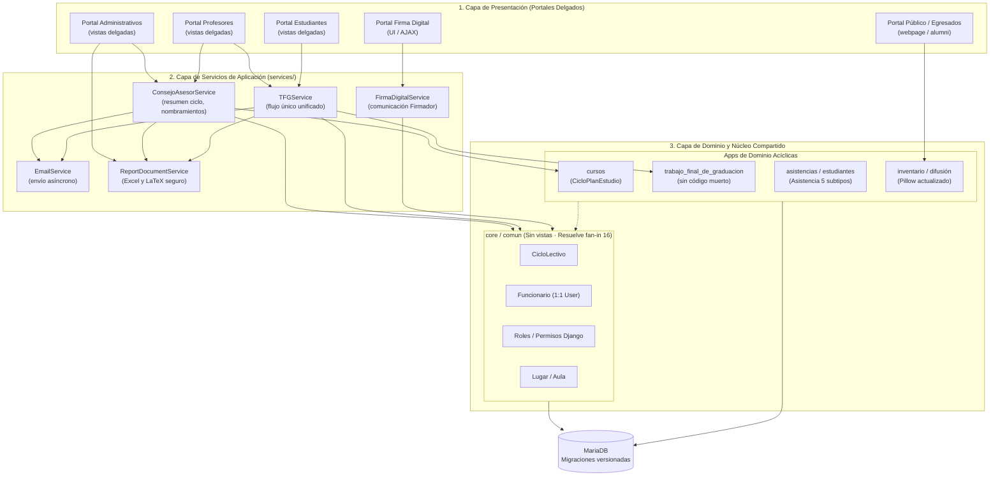

# Auditoría de diseño de software del sistema EIEInfo
## Entrega 3: Informe final de auditoría y propuesta de evolución

- **Curso:** IE0417 – Diseño de Software para Ingeniería
- **Estudiante:** Gabriel Gustavo Ulloa Bermúdez, C27890
- **Fecha:** 19/11/2026
- **Repositorio auditado:** https://github.com/EIE-UCR/eieinfo — **commit:** `d7c8c1b56b0e17a3d53af74dff1487c2f3577422` (14/10/2026)

> Convenciones: `E-xxx` remite al registro de evidencia maestro (`docs/anexos/evidencia.md`); `H2-xx` remite al registro consolidado de 18 hallazgos establecido en la Entrega 2; `INT-xx` identifica las intervenciones prioritarias de ingeniería. En este informe **no se reproducen valores de credenciales**.

**Contenido:** 8.1 Resumen ejecutivo final · 8.2 Arquitectura actual y arquitectura objetivo · 8.3 Hoja de ruta de evolución (Roadmap por fases) · 8.4 Intervenciones prioritarias · 8.5 Propuesta de gobierno técnico · 8.6 Respuestas a las preguntas orientadoras y propuesta de presentación oral · 8.7 Conclusiones finales del proyecto · Anexos

---

## 8.1 Resumen ejecutivo final

### Estado general del sistema
EIEInfo es un monolito Django 4.1.3 con 21 aplicaciones registradas y unas 60 000 líneas de código Python (excluyendo migraciones), con 10 años de historia institucional activa (2016–2026). La auditoría profunda (Entregas 1 y 2) evidenció que en el repositorio conviven **dos generaciones de software**:
1. **El núcleo histórico (2016–2017):** Módulos como `administrativos`, `profesores`, `estudiantes` y `trabajos_finales`, caracterizados por una organización alrededor de portales de usuario, acoplamiento circular masivo (16 apps dependen de `administrativos`, E-019), lógica de negocio y consultas ORM pesadas incrustadas directamente en vistas (118 consultas en `profesores`, 55 en `administrativos`, E-090), 52 excepciones sin tipo (`except:`) silenciadas con directivas `# noqa` (E-039), y 4 524 líneas de código muerto comentado (E-090).
2. **El desarrollo reciente (2025):** Módulos como `firma_digital` y `trabajo_final_de_graduacion`, que muestran hábitos de ingeniería superiores (cero excepciones desnudas, suites de pruebas autosuficientes sin volcados frágiles de base de datos), pero que repiten la tendencia a crear archivos hipertróficos (`firma_digital/views.py` con 2 918 líneas y 77 consultas ORM en vistas, E-005, E-090).

### Fortalezas rescatables
- **Cultura de pruebas preexistente:** El sistema cuenta con un pipeline funcional en Drone CI y una base de 1 165 pruebas automatizadas sin omisiones voluntarias (E-087). `firma_digital` aporta 456 pruebas unitarias aisladas y reproducibles, constituyendo un estándar de referencia interno.
- **Seguridad en capas clave:** Uso correcto de PBKDF2-SHA256 con sal aleatoria criptográfica para el almacenamiento de contraseñas de estudiantes (`E-070`), verificación obligatoria de token CSRF en callbacks locales (`E-063`) y bloqueo a nivel de proxy inverso en nginx para documentos protegidos en `/media/tfg/` (`E-025`).
- **Base modular aprovechable:** A pesar del acoplamiento interno, la división temática por carpetas de Django (`cursos`, `firma_digital`, `inventario`, `atributos`) ofrece una base sólida para evolucionar hacia un monolito modular bien estructurado, sin requerir una reescritura desde cero.

### Riesgos principales
1. **Riesgo crítico de datos y despliegue (R-01, R-04):** Las migraciones de Django se ignoran en Git y se borran y regeneran dinámicamente en cada arranque mediante `migraciones.sh` (`H2-02`). La producción corre en un servidor manual (`faraday`) con servicios desacoplados del Docker probado en CI (`H2-04`).
2. **Riesgo crítico de seguridad e identidad (R-02, R-03):** Claves institucionales, tokens de mensajería y contraseñas expuestas en Git y en un CSV de profesores (`H2-01`), combinadas con un modo de depuración activado por defecto si el hostname no es `faraday` (`H2-03`).
3. **Vulnerabilidades activas en dependencias (R-05):** 143 avisos en OSV (`E-085`). La validación empírica demostró que Pillow 9.4.0 (con 87 avisos de vulnerabilidad) procesa directamente subidas de archivos mediante campos `ImageField` en 5 aplicaciones distintas (`E-093`).
4. **Erosión de la mantenibilidad y cuello de botella cognitivo (R-06, R-08):** Acoplamiento circular entre 25 pares de apps (`H2-06`), funciones con complejidad ciclomática de hasta 39 (`H2-12`) y una concentración del 45 % de los commits históricos en un solo autor (`H2-15`).

### Urgencia de intervención y lectura global
La auditoría demuestra que **lo urgente está en la operación y los datos; lo importante está en la arquitectura del dominio**. Sería una negligencia técnica emprender una refactorización arquitectónica mientras el esquema de base de datos no sea reproducible o las contraseñas sigan expuestas en el historial. Por tanto, la intervención exige una **estabilización inmediata de contingencia (Mes 1)** antes de iniciar la modernización del diseño de software.

---

## 8.2 Arquitectura actual y arquitectura objetivo

### 8.2.1 Síntesis de la arquitectura actual
La arquitectura vigente responde a un **monolito centrado en actores**. La separación de componentes no se trazó por dominios o capacidades de negocio, sino por roles de usuario que interactúan con la interfaz web:
- **`administrativos` como falso núcleo:** Al concentrar los modelos institucionales base (`Ciclo`, `Funcionario`, `Roles`, `Lugar`), absorbió el fan-in de 16 de las otras 20 apps, actuando simultáneamente como interfaz administrativa y como biblioteca central de persistencia.
- **Herencia polimórfica que cruza fronteras:** El modelo `Profesor` (en `profesores`) hereda mediante `django-polymorphic` de `Funcionario` (en `administrativos`), creando un acoplamiento bidireccional estructural indisoluble.
- **Inexistencia de una capa de servicios:** La orquestación de transacciones, envío de correos (`EmailService`), generación de documentos LaTeX/Excel y consultas ORM complejas conviven dentro de vistas-función que superan las 2 000 líneas.
- **Duplicación funcional:** Portales homólogos copian código para realizar tareas idénticas; por ejemplo, 8 funciones completas de `consejo_asesor.py` están duplicadas entre `administrativos` y `profesores` (348 líneas idénticas, `E-077`).

### 8.2.2 Arquitectura objetivo razonable: Monolito Modular con Capa de Servicios
Se descarta formalmente una reescritura hacia microservicios por resultar contraproducente e inviable para la escala del equipo y la infraestructura institucional. La arquitectura objetivo consolida un **Monolito Modular estricto** organizado en tres capas bien definidas con dependencias unidireccionales descendentes:


_Fuente: diagrama formal compilable en `docs/diagramas/06-arquitectura-objetivo.dot` y `.mmd`._

#### Componentes estructurales de la arquitectura objetivo:
1. **Núcleo de Dominio Compartido (`core` o `comun`):** Aplicación Django aislada **sin vistas ni rutas web**. Aloja exclusivamente las entidades institucionales de las que todos dependen: `CicloLectivo` (resuelve la ambigüedad con el ciclo de planes de estudio), `Funcionario` (modelo base polimórfico vinculado 1:1 con `User`), `Roles` y `Lugar`. Resuelve de raíz el fan-in de 16 apps hacia `administrativos`.
2. **Capa de Servicios de Aplicación (`services/`):** Clases y funciones de servicio puras encargadas de la orquestación, transacciones de base de datos, generación de documentos y comunicación externa. Las vistas web se convierten en controladores delgados que solo validan entradas, llaman al servicio correspondiente y renderizan el resultado.
3. **Portales de Presentación Delgados:** `profesores`, `estudiantes` y `administrativos` se despojan de modelos y lógica de negocio cruzada, limitándose a estructurar URLs, plantillas y formularios de entrada para sus respectivos actores.
4. **Dominio Académico y de Graduación Desacoplado:** Unificación definitiva de `trabajo_final_de_graduacion` (retirando las 1 385 líneas comentadas de `trabajos_finales`, E-090), y renombre de `Ciclo` en `cursos` a `CicloPlanEstudio` (`E-074`).

### 8.2.3 Comparación analítica y problemas resueltos

| Dimensión | Arquitectura Actual | Arquitectura Objetivo (Monolito Modular) | Problema que resuelve |
|---|---|---|---|
| **Eje organizativo** | Por actor/portal de usuario (`administrativos`, `profesores`, `estudiantes`). | Por capacidad de negocio y capas (Presentación → Servicios → Dominio/Core). | Dispersión de dominio (`H2-10`) y código duplicado (`H2-11`). |
| **Punto central de acoplamiento** | `administrativos` actúa como vista y almacén de datos (fan-in 16, fan-out 9). | Módulo `core` independiente, puro y sin vistas (fan-in acíclico hacia abajo). | Acoplamiento circular (`H2-06`) y alto radio de impacto de cambios. |
| **Ubicación de lógica de negocio** | En vistas web (118 consultas ORM en `profesores`, 77 en `firma_digital`). | En módulos de servicio (`services/`), desacoplada del protocolo HTTP. | Vistas sobredimensionadas (`H2-12`) e imposibilidad de probar transacciones sin navegador. |
| **Control de acceso** | ~20 decoradores artesanales repartidos en 6 archivos `misc.py` con alias engañosos. | Sistema estándar de Grupos y Permisos de Django con mixins uniformes en vistas. | Fragilidad de autorización (`H2-13`) y falta de auditabilidad de accesos. |
| **Gestión de base de datos** | Migraciones borradas y regeneradas al vuelo con `migraciones.sh`. | Migraciones versionadas en Git, probadas en CI y aplicadas con `migrate` determinista. | Riesgo de corrupción o pérdida total de datos (`H2-02`). |

### 8.2.4 Trade-offs y costos de transición
- **Costo de migración de modelos (Squash & Freeze):** Mover tablas de base de datos entre aplicaciones de Django (`administrativos` → `core`) requiere migraciones manuales con `SeparateDatabaseAndState` o la fijación temporal de `db_table` para no recrear tablas existentes en producción ni requerir ventanas de mantenimiento prolongadas.
- **Sobrecarga transaccional inicial:** Introducir una capa de servicios formal requiere reescribir llamadas en cientos de vistas existentes. Esto se mitigará aplicando el patrón *Branch by Abstraction* y refactorizando primero los módulos de mayor impacto funcional (`consejo_asesor` y `firma_digital`).
- **Disciplina de equipo:** Requiere establecer directrices estrictas de linting para prohibir imports cruzados entre portales (gobernanza técnica).

---

## 8.3 Hoja de ruta de evolución (Roadmap por fases)

La transición se planifica en **cinco fases cronológicas y secuenciales**, abarcando un horizonte realista de 12 meses:

```
[Mes 1]               [Meses 2–3]            [Meses 4–6]            [Meses 7–9]            [Meses 10–12]
Fase 1: Mitigación    Fase 2: Red de         Fase 3: Refactor       Fase 4: Modernización  Fase 5: Despliegue
Crítica y Entorno     Seguridad y Linter     Modular y Core         Django 4.2 y Acceso    Continuo y Métricas
  │                      │                      │                      │                      │
  ├─ Rotar secretos      ├─ Tests caracteriz.   ├─ Extraer 'core'      ├─ Subir a Django 4.2  ├─ Drone CD real
  ├─ Baseline migrac.    ├─ Eliminar c. muerto  ├─ Capa de servicios   ├─ Actualizar Pillow   ├─ Quitar sleep 200
  └─ Settings único      └─ Reemplazar except:  └─ Unificar C. Asesor  └─ Permisos estándar   └─ Logging unificado
```

### Tabla consolidada de la hoja de ruta

| Fase | Duración | Objetivo principal | Alcance técnico | Riesgos y Dependencias | Esfuerzo estimado |
|---|---|---|---|---|---|
| **Fase 1: Mitigación crítica y estabilización** | Mes 1 (sem. 1–4) | Detener la exposición de credenciales y asegurar determinismo en la persistencia. | Purgar secretos en Git (`H2-01`); eliminar CSV de contraseñas; unificar `settings.py` con `django-environ` (`H2-03`); crear migración baseline y erradicar `migraciones.sh` (`H2-02`); corregir permisos MySQL para suite local (`H2-08`). | **Riesgo:** Bloqueo de accesos si una clave rotada no se propaga a producción.<br/>**Dependencia:** Acceso administrativo al repo y al servidor. | 4 semanas-persona (Bajo) |
| **Fase 2: Red de seguridad y saneamiento** | Meses 2–3 (sem. 5–12) | Establecer una red de pruebas confiable y erradicar el ruido en el código. | Escribir pruebas de caracterización sobre `resumen_ciclo` y `editar_grupo`; purgar 4 524 líneas de código muerto (`H2-16`, `E-090`); reemplazar los 52 `except:` desnudas por excepciones concretas con log (`H2-14`); activar `flake8` en CI. | **Riesgo:** Destapar fallos silenciosos en producción al retirar los `except:`.<br/>**Dependencia:** Fase 1 concluida (entorno local reproducible). | 8 semanas-persona (Medio) |
| **Fase 3: Refactorización modular y servicios** | Meses 4–6 (sem. 13–24) | Desmantelar el acoplamiento circular y desacoplar la lógica de negocio de las vistas. | Crear app `core` (`CicloLectivo`, `Funcionario`, `Roles`); unificar las 8 funciones de `consejo_asesor` (`H2-11`); descomponer `editar_grupo` (CC 33) y `enviar_email` (CC 39) (`H2-12`); introducir `services/` (correo, reportes, TFG). | **Riesgo:** Inconsistencias de esquema al mover modelos polimórficos.<br/>**Dependencia:** Pruebas de caracterización de la Fase 2. | 14 semanas-persona (Alto) |
| **Fase 4: Modernización de plataforma y seguridad** | Meses 7–9 (sem. 25–36) | Cerrar brechas de vulnerabilidades y estandarizar la política de autorización. | Actualizar a Django 4.2 LTS (techo marcado por `django-sekizai`/`django-classy-tags`, `E-091`); desinstalar `django-instagram` y `PyPDF2` (`E-080`); actualizar Pillow 9.4.0 (`E-093`); unificar decoradores a grupos/permisos Django (`H2-13`); escape estricto de LaTeX (`H2-09`). | **Riesgo:** Incompatibilidades en plantillas o templatetags antiguos.<br/>**Dependencia:** Fase 3 (lógica desacoplada de vistas). | 10 semanas-persona (Medio/Alto) |
| **Fase 5: Despliegue continuo y observabilidad** | Meses 10–12 (sem. 37–48) | Cerrar la brecha entre CI y producción mediante entrega automatizada y monitoreo. | Automatizar despliegue en Drone con imágenes inmutables probadas en CI (`H2-04`); eliminar `sleep 200` mediante healthchecks; versionar configuración de nginx/systemd de producción; unificar logging estructurado (`H2-18`). | **Riesgo:** Ventana de caída durante la transición de servicios en host `faraday`.<br/>**Dependencia:** Fases 1 a 4 consolidadas. | 6 semanas-persona (Medio) |

---

## 8.4 Intervenciones prioritarias

Se definen **7 intervenciones concretas de ingeniería**, priorizadas para su ejecución inmediata y a mediano plazo:

### INT-01 · Higienización de secretos y gestión externa de variables de entorno
- **Problema que atiende:** `H2-01` (Secretos y credenciales versionados, `E-010`, `E-011`, `E-013`, `E-037`).
- **Beneficio esperado:** Eliminación definitiva de credenciales de correo, claves de Imgur, tokens de Telegram y contraseñas de profesores en el repositorio e historial de Git. Configuración limpia mediante estándar *Twelve-Factor App*.
- **Riesgo de implementación:** Bajo. Requiere coordinación previa para sincronizar las nuevas variables de entorno en el servidor de producción antes de reescribir el historial.
- **Esfuerzo relativo:** 1 semana-persona.
- **Prioridad:** **Inmediata (Semana 1)**.

### INT-02 · Establecimiento de línea base y versionado de migraciones
- **Problema que atiende:** `H2-02` (Migraciones ignoradas y regeneradas dinámicamente, `E-007`, `E-008`).
- **Beneficio esperado:** Eliminación de `migraciones.sh`. Persistencia determinista y trazable; capacidad de aplicar cambios incrementales al esquema de base de datos sin riesgo de inconsistencias ni pérdida de información.
- **Riesgo de implementación:** Medio. Exige generar una migración inicial sincronizada con el estado exacto de la base de datos de producción (`migrate --fake-initial`).
- **Esfuerzo relativo:** 1 semana-persona.
- **Prioridad:** **Inmediata (Semana 2)**.

### INT-03 · Unificación de configuración y saneamiento de dependencias inicial
- **Problema que atiende:** `H2-03` y `H2-05` (Configuraciones divergentes y dependencias huérfanas, `E-024`, `E-080`, `E-081`, `E-092`).
- **Beneficio esperado:** Un único `settings.py` parametrizado por variables (`DEBUG = False` por defecto); erradicación de forks no mantenibles de GitHub; retiro de `PyPDF2` (que no se usa); corrección del aviso `USE_L10N` de cara a Django 5.0.
- **Riesgo de implementación:** Bajo.
- **Esfuerzo relativo:** 1 semana-persona.
- **Prioridad:** **Alta (Semanas 3–4)**.

### INT-04 · Habilitación de suite de pruebas local y pruebas de caracterización
- **Problema que atiende:** `H2-08` y `H2-12` (Pruebas no reproducibles y funciones complejas, `E-016`, `E-038`, `E-087`).
- **Beneficio esperado:** Otorgar permisos al usuario `info` en MySQL para levantar la base de pruebas localmente sin error 1044. Creación de pruebas de caracterización sobre los algoritmos más críticos (`resumen_ciclo`, `editar_grupo`) que actúen como arnés de seguridad para la refactorización.
- **Riesgo de implementación:** Bajo.
- **Esfuerzo relativo:** 3 semanas-persona.
- **Prioridad:** **Alta (Mes 2)**.

### INT-05 · Extracción del núcleo de dominio (`core`) y desacoplamiento de portales
- **Problema que atiende:** `H2-06` y `H2-10` (Acoplamiento circular con `administrativos` y dominio ambiguo, `E-019`, `E-061`, `E-074`).
- **Beneficio esperado:** Eliminación de los 79 imports de 16 apps hacia `administrativos`. Aislamiento de `CicloLectivo`, `Funcionario` y `Roles` en un paquete `core` puro. Renombrado de `Ciclo` en `cursos` a `CicloPlanEstudio` para erradicar la ambigüedad conceptual.
- **Riesgo de implementación:** Alto. Exige mapeo preciso en el ORM de Django manteniendo `db_table` fija para evitar migraciones destructivas en las tablas base.
- **Esfuerzo relativo:** 5 semanas-persona.
- **Prioridad:** **Alta (Meses 4–5)**.

### INT-06 · Unificación de lógica de Consejo Asesor y extracción a capa de servicios
- **Problema que atiende:** `H2-07`, `H2-11` y `H2-12` (Código copiado entre portales y vistas gigantes, `E-041`, `E-071`, `E-077`, `E-090`).
- **Beneficio esperado:** Eliminación de las 348 líneas de código idéntico entre `administrativos` y `profesores`. Centralización del cálculo del ciclo en `ConsejoAsesorService`, reduciendo la complejidad ciclomática de `resumen_ciclo` y permitiendo pruebas unitarias sin contexto HTTP.
- **Riesgo de implementación:** Medio. Requiere asegurar que ambos portales sigan recibiendo el mismo contexto visual a través del servicio.
- **Esfuerzo relativo:** 3 semanas-persona.
- **Prioridad:** **Media (Meses 5–6)**.

### INT-07 · Erradicación de código muerto y activación de linters en CI
- **Problema que atiende:** `H2-14`, `H2-16` y `H2-17` (Código muerto, residuos y linters silenciados, `E-042`, `E-053`, `E-076`, `E-090`).
- **Beneficio esperado:** Eliminación física de las 1 385 líneas comentadas en `trabajos_finales` y de los archivos residuales. Corrección de los 14 escapes inválidos en regex (`E-092`). Eliminación de `# noqa` para excepciones desnudas e inclusión del chequeo de `flake8` en el pipeline de Drone.
- **Riesgo de implementación:** Muy bajo.
- **Esfuerzo relativo:** 2 semanas-persona.
- **Prioridad:** **Media (Meses 2–3)**.

---

## 8.5 Propuesta de gobierno técnico

Para garantizar que el sistema mantenga su integridad arquitectónica y no vuelva a acumular deuda técnica incontrolada, se establecen seis políticas mínimas obligatorias:

### 1. Reglas de manejo de secretos y configuración
- **Tolerancia cero a credenciales en control de versiones:** Ninguna clave, contraseña o token puede comprometerse en Git. Se implementará un hook de pre-commit con `gitleaks` o `detect-secrets` que rechace commits con cadenas sensibles.
- **Plantilla pública y parametrización externa:** Solo se versionará un archivo `.env.example` con variables documentadas y valores ficticios. En desarrollo y CI, las variables se inyectarán mediante Docker Compose; en producción, mediante el gestor de secretos de la infraestructura.

### 2. Criterios de aceptación de cambios (Definition of Done)
Ninguna contribución podrá fusionarse a la rama principal (`main`) sin satisfacer las siguientes condiciones:
1. **Pruebas automatizadas asociadas:** Cada nueva funcionalidad o corrección debe incluir pruebas unitarias autosuficientes (siguiendo el patrón observado en `firma_digital`), sin depender de volcados estáticos `dumpdata`.
2. **Cobertura no decreciente:** El reporte de `coverage` en Drone debe mantener o incrementar la cobertura sobre las aplicaciones modificadas.
3. **Validación estática limpia:** El código debe pasar `flake8` sin nuevos comentarios `# noqa` y `bandit` sin avisos de nivel Medio o Alto.
4. **Migraciones reversibles:** Todo cambio de modelo debe acompañarse de sus archivos de migración generados y probados bidireccionalmente (`migrate` y rollback).

### 3. Estrategia de pruebas: La Pirámide Pragmática de Django
- **Nivel base (70 % - Unitarias puras):** Pruebas veloces sobre la capa de servicios (`services/`), utilidades de cálculo y validaciones de formularios, sin tocar base de datos ni renderizar plantillas HTTP.
- **Nivel medio (25 % - Integración de modelos y consultas):** Pruebas de modelos contra base de datos en memoria (SQLite en pruebas rápidas o MariaDB en CI), utilizando `factory_boy` para generar datos controlados en lugar de fixtures pesadas.
- **Nivel superior (5 % - Pruebas de humo de integración):** Pruebas de endpoints críticos en CI verificando códigos de respuesta HTTP y permisos de acceso por rol.

### 4. Prácticas de revisión técnica y autoría
- **Revisión por pares obligatoria (Peer Review):** Todo cambio requiere la aprobación de al menos un revisor antes del merge para mitigar el riesgo de concentración de conocimiento (`H2-15`).
- **Normalización de identidad:** Incorporación inmediata de un archivo `.mailmap` en la raíz del repositorio para unificar los 34 alias de autores identificados y garantizar una trazabilidad clara de la responsabilidad técnica.

### 5. Lineamientos de diseño y modularidad
- **Regla de dependencias acíclicas:** El grafo de dependencias de Django debe ser estrictamente acíclico y descendente: `Portales (Presentación) → Servicios → Dominio/Core`.
- **Prohibición de imports cruzados entre portales:** Ningún módulo bajo `profesores`, `estudiantes` o `administrativos` podrá importar modelos, vistas o utilidades de otro portal.
- **Uso exclusivo de la interfaz oficial de configuración:** Se prohíbe terminantemente `import eieinfo.settings`; todo acceso a variables de configuración debe realizarse mediante `from django.conf import settings` (`E-027`).

### 6. Documentación técnica mínima requerida
- **Registros de Decisiones de Arquitectura (ADRs):** Adopción del estándar ADR en `docs/adr/` para registrar formalmente cada decisión estructural de impacto (ej. extracción de `core`, unificación de `Ciclo`, actualización a Django 4.2).
- **Glosario vivo del dominio:** Mantenimiento de un glosario técnico en el repositorio que clarifique y unifique los términos ambiguos identificados en la auditoría (diferenciando `CicloLectivo` de `CicloPlanEstudio`, y `TFG` de `ProyectoElectrico`).
- **Guía de onboarding reproducible:** Documentación del procedimiento de instalación y puesta en marcha del entorno de desarrollo local en un máximo de tres comandos documentados en el `README.md`.

---

## 8.6 Respuestas a las preguntas orientadoras y propuesta de presentación oral

### 8.6.1 Respuestas a las preguntas orientadoras (§8)

1. **¿Qué debería hacerse en el primer mes si un equipo nuevo heredara el sistema?**  
   Ejecutar de inmediato la **Fase 1 (Mitigación crítica)**: (a) Rotar credenciales comprometidas y purgar el historial de Git, (b) crear una migración baseline eliminando `migraciones.sh`, (c) unificar `settings.py` con variables de entorno, y (d) otorgar privilegios en MySQL para que el comando local `manage.py test` corra de forma reproducible en los entornos de los desarrolladores.
2. **¿Qué riesgos deben mitigarse de inmediato?**  
   El riesgo de corrupción o inconsistencia del esquema de base de datos (`H2-02`) y el riesgo de uso indebido de cuentas y credenciales institucionales expuestas (`H2-01`), sumado al vector de explotación directo en Pillow por procesamiento de `ImageField` (`H2-05`, `E-093`).
3. **¿Qué partes conviene preservar y cuáles reestructurar?**  
   **Preservar:** La suite de pruebas y el diseño desacoplado de `firma_digital`, el pipeline base de CI en Drone, las reglas de hashing de contraseñas de estudiantes y el modelo de datos de cursos y comisiones.  
   **Reestructurar:** El núcleo central de `administrativos` (extrayéndolo a `core`), las vistas gigantescas y duplicadas de `consejo_asesor.py`, y la dispersión de utilidades en `webpage.misc` y `eieinfo.misc`.
4. **¿Cómo puede evolucionarse el sistema sin interrumpir su operación?**  
   Manteniendo la base monolítica y aplicando técnicas de refactorización segura: escribir pruebas de caracterización antes de tocar código heredado, utilizar el patrón *Branch by Abstraction* para intercalar la capa de servicios sin modificar la interfaz de usuario, y fijar nombres de tablas en el ORM (`db_table`) para evitar recreaciones disruptivas de esquemas en la base de datos de producción.
5. **¿Qué prácticas de diseño y gobernanza faltan hoy?**  
   Falta una política estricta de gestión de secretos, una definición consensuada de «terminado» (*Definition of Done*), control de linters obligatorio en el CI, revisión cruzada de código y documentación de decisiones arquitectónicas mediante ADRs.

---

### 8.6.2 Estructura y guion estratégico para la presentación oral (§8.6)

Se propone organizar la defensa oral del proyecto en **cinco bloques temáticos**, alineados con la plantilla de diapositivas en `docs/presentacion/presentacion-final.Rmd`:

| Bloque | Tiempo sug. | Diapositivas clave | Mensaje central y énfasis de defensa |
|---|:---:|---|---|
| **I. Diagnóstico y Hallazgos Críticos** | 3 min | 1. Portada y contexto institucional.<br/>2. El sistema en cifras (60k LOC, 21 apps, 10 años).<br/>3. Los 18 hallazgos consolidado y los 2 críticos (`H2-01`, `H2-02`). | «EIEInfo funciona y sostiene la Escuela, pero sus mayores riesgos no están en la lógica de negocio sino en la operación: secretos expuestos y migraciones no controladas.» |
| **II. Radiografía Modular y del Dominio** | 3 min | 4. Cadenas causales (Árbol de causas `05-causas.svg`).<br/>5. Diagrama de Dominio (`04-dominio.svg`) y ambigüedad de los dos `Ciclo`.<br/>6. Radiografía de código: 4 524 líneas comentadas y 118 consultas ORM en vistas. | «La organización histórica por portales de actor convirtió a `administrativos` en un núcleo parásito y forzó la duplicación de código en el consejo asesor.» |
| **III. La Arquitectura Objetivo** | 4 min | 7. Comparación Actual vs. Objetivo (Monolito Modular).<br/>8. Diagrama de Arquitectura Objetivo (`06-arquitectura-objetivo.svg`).<br/>9. Las 3 capas: Portales delgados → Servicios → Core de Dominio. | «No proponemos una reescritura mágica hacia microservicios. Proponemos un Monolito Modular con Capa de Servicios y un módulo `core` limpio sin vistas que rompa el acoplamiento circular.» |
| **IV. Hoja de Ruta e Intervenciones** | 3 min | 10. Hoja de ruta en 5 fases (Mes 1 a Mes 12).<br/>11. Intervenciones prioritarias inmediatas (INT-01 a INT-04).<br/>12. Modernización tecnológica: Por qué Django 4.2 LTS primero (`E-091`). | «Separamos lo urgente de lo importante. El primer mes estabiliza la operación; a partir del segundo mes se refactoriza bajo una red de pruebas de caracterización.» |
| **V. Gobierno Técnico y Conclusión** | 2 min | 13. Políticas de gobierno (Secretos, DoD, Pruebas).<br/>14. Conclusiones y lecciones aprendidas de ingeniería. | «Una auditoría profesional no destruye código antiguo: comprende sus restricciones históricas, protege la operación y traza una ruta de modernización viable.» |

---

## 8.7 Conclusiones finales del proyecto

1. **El valor de una auditoría basada en evidencia:** A lo largo de las tres semanas de trabajo se construyó un registro maestro de 93 evidencias empíricas (`E-001` a `E-093`), permitiendo descartar suposiciones iniciales y demostrar con mediciones concretas problemas como el peso del código muerto (48.4 % en `trabajos_finales`), la duplicación textual (348 líneas en `consejo_asesor`) y los techos reales de actualización de dependencias (`django-sekizai` y Django 4.2).
2. **Ingeniería incremental frente al mito de la reescritura:** EIEInfo demuestra que los sistemas institucionales vivos rara vez pueden reescribirse desde cero sin poner en riesgo la continuidad de la organización. La estrategia planteada de **Monolito Modular** rescata las fortalezas del sistema, respeta la curva de aprendizaje del equipo y resuelve los defectos estructurales de forma sostenible.
3. **El software como disciplina socio-técnica:** La acumulación de deuda técnica en EIEInfo no obedeció a impericia técnica, sino a la falta de gobernanza: autoría concentrada, ausencia de revisiones cruzadas y linters silenciados. La adopción de las políticas de gobierno técnico propuestas es la única garantía de que la modernización perdure en el tiempo.

---

## Anexos

- **A. Registro maestro de evidencia:** `docs/anexos/evidencia.md` (Catálogo maestro desde `E-001` hasta `E-093`).
- **B. Diagramas del proyecto:**
  - `docs/diagramas/01-contexto.svg`: Diagrama de contexto general del sistema.
  - `docs/diagramas/02-contenedores.svg`: Arquitectura de despliegue y contenedores.
  - `docs/diagramas/03-dependencias-apps.svg`: Grafo de acoplamiento entre aplicaciones.
  - `docs/diagramas/04-dominio.svg`: Diagrama entidad-relación del dominio central.
  - `docs/diagramas/05-causas.svg`: Árbol de relaciones causales entre los 18 hallazgos.
  - `docs/diagramas/06-arquitectura-objetivo.dot` y `.mmd`: Especificación de la arquitectura objetivo.
- **C. Salidas crudas de auditoría:** Ubicadas en `docs/anexos/recon/` y `docs/anexos/recon2/`.
- **D. Diapositivas de defensa oral:** `docs/presentacion/presentacion-final.Rmd`.
